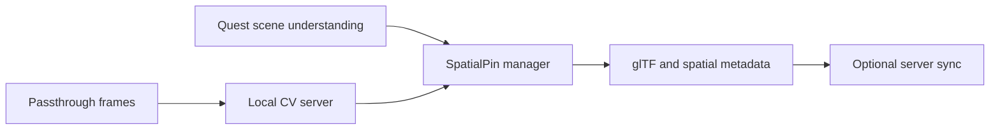
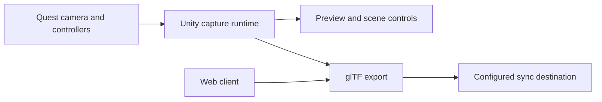

<h1 align="center">Companion Scan</h1>

<p align="center"><strong>Companion Scan includes both a native Quest 3 Unity runtime and a WebXR web client.</strong></p>

[](https://github.com/companionintelligence/CI-Spatial-Unity/releases)
[](https://github.com/companionintelligence/CI-Spatial-Unity)
[](LICENSE)
[](https://discord.com/invite/yQp9hwpzAa)

<p align="center"><a href="https://xr.ci.computer">Website</a> · <a href="#documentation">Documentation</a> · <a href="#quick-start">Get started</a> · <a href="https://docs.ci.computer/docs/reference/open-source-systems">Systems map</a></p>

<p align="center">
  <a href="#quick-start"></a>
</p>

Both clients combine scene understanding with a local CV server (Grounding DINO,
SAM 2, Florence-2) to produce a glTF export with rich spatial metadata and sync
it back to the server.


## Features

| Feature | What it provides |
|---|---|
| **On-device scene query** | Read Meta Scene Understanding planes, volumes and labels on Quest. |
| **Local CV pipeline** | Send passthrough frames to a separately hosted detector and segmenter. |
| **Shared spatial pins** | Merge detections with provenance in one spatial pin store. |
| **Portable output** | Export pins and metadata to glTF for review and sync. |


## Overview

This repository now ships two capture front ends that target the same local CV
server and export pipeline:

- **Unity Quest runtime** — the original native headset experience under
  `Assets/CompanionScan/`
- **Web client** — a Vite/TypeScript WebXR client under `web/` for Quest Browser
  and desktop fallback workflows

Two independent capture systems feed a **unified spatial pin store**:

- **Meta Scene Understanding** (Pipeline A) — on-device OVRAnchor queries for semantic labels, planes, volumes. No network needed. See [Meta Scene API docs](https://developers.meta.com/horizon/documentation/unity/unity-scene-overview/).
- **CV Server Pipeline** (Pipeline B) — passthrough camera frames → Florence2 → GroundingDINO → SAM2 via a local Docker server. Raycasts detections into world space.

Both pipelines write `SpatialPin` objects (tagged `CvServer` or `MetaScene`) to the shared `SpatialPinManager`. The glTF export merges data from both sources.

## Key Paths

- Scene: `Assets/CompanionScan/Scenes/CompanionCapture.unity`
- QA XR Scene: `Assets/CompanionScan/Scenes/CompanionScanQA.unity`
- Companion Scan runtime: `Assets/CompanionScan/`
- Controller UI: `Assets/CompanionScan/UI/`
- CV server: `cv-server/`
- Web client: `web/`


## How it fits together

Two capture pipelines converge on one SpatialPin manager: Meta Scene Understanding runs on-device, while optional CV analysis runs on a local server; both feed the glTF exporter.



## Architecture (Unity Quest Runtime)

```text
Quest 3 App
  ├─ Pipeline A: Meta Scene Understanding (on-device)
  │    OVRAnchor → OVRRoomLayout → OVRSemanticLabels
  │    → MetaSceneSnapshot → SpatialPin (MetaScene)
  │
  ├─ Pipeline B: CV Server (network)
  │    Camera JPEG → Florence2 caption + OD
  │    → GroundingDINO detect → SAM2 segment
  │    → Raycast → SpatialPin (CvServer)
  │
  ├─ SpatialPinManager (unified pin store)
  │
  ├─ XR Controller Input (button → action dispatch)
  │
  └─ glTF export + sync → /v1/gltf

Local CV Server (Docker)
  - /v1/detect   (GroundingDINO)
  - /v1/segment  (Grounded SAM 2)
  - /v1/florence  (Florence-2)
  - /v1/gltf     (upload)
```

## Controller Button Mapping

All interaction uses the physical Quest controller buttons — no world-space
UI panels. Each button has a coloured circle indicator and label attached
to the controller model at runtime.

### Right Controller

| Button | Colour | Action | Details |
|--------|--------|--------|---------|
| **A** | Red | **Capture** | Takes a snapshot. Runs both Meta Scene + CV Server pipelines (respects current model preset). 3D labels persist after each capture. |
| **B** | Blue | **Cycle Model** | Cycles the active AI model preset: Florence → GDino → SAM2 → Florence … |

### Left Controller

| Button | Colour | Action | Details |
|--------|--------|--------|---------|
| **X** | Yellow | **Preview Distance** | Cycles the raycaster fallback distance: Near (1 m) → Far (3 m) → Off → Near … |
| **Y** | Green | **Save & Export** | Exports glTF and uploads to the CV server via `GltfSyncClient`. |
| **Menu** | — | **Server settings** | Opens or closes the CV server settings panel (it also opens on first run). While it is open, **A** edits the server URL, **X** the server's API token (secure keyboard; stored on the headset only, never shown) and **B** saves; the other controls pause. |

### Either Controller

| Button | Colour | Action | Details |
|--------|--------|--------|---------|
| **Index Trigger** | Orange | **Display Mode** | Cycles visualisation: BoundingBox2D → SpatialLabel3D → Both → BoundingBox2D … |

### Wrist HUD

A small world-space panel is attached to the left controller wrist showing
the current state:

```
Model: Florence
Display: Both
Preview: Near (1m)
BUSY…            ← shown during capture
```

### Model Presets

| Preset | Florence | GDino | SAM2 |
|--------|----------|-------|------|
| Florence | ✓ | – | – |
| GDino | – | ✓ | – |
| SAM2 | – | – | ✓ |

### Display Modes

| Mode | 2D BBox Overlay | 3D Spatial Labels |
|------|----------------|-------------------|
| BoundingBox2D | ✓ | – |
| SpatialLabel3D | – | ✓ |
| Both | ✓ | ✓ |

3D spatial labels **persist** across captures by default. The pin manager can
optionally prune stale pins and merge updates by track ID to reduce clutter.

### Preview Distance

Controls the `ViewportRaycaster` fallback distance used when no AR plane,
semantic plane, or physics surface is hit:

| Setting | Distance |
|---------|----------|
| Near | 1 m |
| Far | 3 m |
| Off | 0 m (disabled) |

### Camera Preview + Frustum

- A world-space preview panel shows the latest camera frame with 2D box overlays.
- Frustum rays are drawn on capture using the current preview distance.
- On Quest, passthrough camera capture should use Meta OpenXR + ARFoundation PCA.
   If WebCamTexture is used, ensure camera permission is granted.

## Quick Start

### Unity Quest Runtime

Use Unity `6000.6.9f1`, the editor version pinned in
`ProjectSettings/ProjectVersion.txt`, with the Android Build Support module
(including OpenJDK and Android SDK & NDK Tools).

1. **Run the CV server**
   - See [cv-server/README.md](cv-server/README.md) for local Docker setup.

2. **Create a Server Config asset**
   - Project window → Create → Companion Scan → Server Config.
   - Set `baseUrl` to your server IP (example: `https://my-server.ts.net`).

3. **Open the Quest scene**
   - `Assets/CompanionScan/Scenes/CompanionCapture.unity`.

4. **Wire the mapper components**
    - See [docs/quest-capture-gltf.md](docs/quest-capture-gltf.md) for the full component list.
    - Make sure `ControllerMenuBuilder` exists on a GameObject in the scene — it
       auto-discovers all pipeline/renderer/exporter references and builds the
       controller indicators + HUD at runtime.

5. **Build to Quest 3**
   - Menu → CompanionScan → Build Quest APK (writes `Builds/Quest/CompanionScan.apk`),
     or Build and Run Quest APK to install it on the connected headset. These are
     development builds signed with your debug key; builds for a store or for
     testers come from
     [Release builds from the command line](#release-builds-from-the-command-line)
     or from a tagged CI build.
   - CI builds come from the [Quest APK Build](#continuous-integration-and-releases)
     workflow. To install either APK, see [docs/SIDELOAD.md](docs/SIDELOAD.md).
   - Run Space Setup on the headset and grant `com.oculus.permission.USE_SCENE`.

6. **Use the controller**
    - **A** — capture (both pipelines run, 3D labels appear in world space).
    - **B** — switch model if you only want one AI model active.
    - **X** — change preview distance.
    - **Y** — export and upload glTF.
    - **Trigger** — toggle between 2D boxes, 3D labels, or both.

### Web Client

1. **Install dependencies**
   ```bash
   cd web
   npm install
   ```
2. **Run locally**
   ```bash
   npm run dev
   ```
3. **Open the web client**
   - Visit `http://localhost:5173`
   - Click **Start Desktop** for webcam-based testing on non-WebXR browsers
   - On Meta Quest Browser, use **Enter AR** for passthrough scanning

For full web setup, architecture, deployment, and automated browser test
instructions, see [web/README.md](web/README.md).

## glTF Export + Sync

- Exports `.gltf` + `.bin` and injects extras for:
  - Unified pins from both CV Server and Meta Scene (tagged by `source`)
  - CV-derived floorplan and bounds
   - Full Meta scene anchor data (labels, planes, volumes, optional meshes)
   - Pin metadata: `capture_id`, `capture_session_id`, `capture_frame_index`,
      `placement_confidence`, `hit_type`, `track_id`
- Uploads to the local server at `POST /v1/gltf`.

## Testing

### Play-Mode Integration Tests

`Assets/CompanionScan/Tests/PlayMode/PerImageModelTests.cs` contains 9
integration tests that run all three models against 14 fixture images:

| Test | What it checks |
|------|---------------|
| Florence2_Caption_AllImages | Caption string returned for every image |
| Florence2_OD_AllImages | Object detection returns bboxes + labels |
| GDino_Detect_AllImages_BboxesValid | GroundingDINO bboxes are normalised 0–1 |
| GDino_Detect_AllImages_Anchors3D | Raycasted world positions are valid |
| SAM2_Segment_AllImages_MasksValid | SAM2 returns non-empty mask data |
| SAM2_Segment_AllImages_Anchors3D | Segmentation anchors raycast correctly |
| FullPipeline_PerImage_AllThreeModels | Full Florence→GDino→SAM2 pipeline |
| BBox2D_RenderingData_ValidForAllDetections | 2D rendering data is valid |
| Anchor3D_PinData_ValidForAllDetections | 3D pin data is valid |

Run via Unity Test Runner (Play Mode) or CI. They need a running CV server:
set `CompanionScan_TEST_SERVER_URL` to its URL and `CompanionScan_API_TOKEN` to
its API token (`CV_SERVER_API_TOKEN`) in the environment of the Unity editor.
Without a server URL the server tests are skipped or fail.

### QA XR Scene Asset

Open `Assets/CompanionScan/Scenes/CompanionScanQA.unity` for a persistent QA
scene that focuses on button-driven UX validation (controller indicators + HUD).

### CI (Self-hosted GPU Runner)

The Unity Tests workflow targets a Windows self-hosted runner with GPU support.
Ensure:

- Runner labels include `self-hosted`, `windows`, `x64`, `gpu`.
- The runner is GitHub Actions runner 2.327.1 or newer (the pinned actions run
  on Node.js 24).
- cv-server is running as a stable local service on this machine.
- Health check is available at `http://localhost:8000/v1/health`; like every
  cv-server route it needs `Authorization: Bearer <CV_SERVER_API_TOKEN>` (the
  `CV_SERVER_API_TOKEN` repository secret).

Pull requests run the unit tests; the cv-server integration tests run when the
workflow is started by hand. See
[Continuous integration and releases](#continuous-integration-and-releases).

### CV Server Tests

```bash
cd cv-server
pytest
```

## Continuous integration and releases

| Workflow | Runner | Starts on | Output |
|---|---|---|---|
| [Unity Tests](.github/workflows/unity-tests.yml) | Self-hosted Windows GPU | Pull requests to `main` that change `Assets/`, `Packages/`, `ProjectSettings/` or `test/` (unit tests); manual runs (unit and cv-server integration tests) | Test results and screenshots |
| [Web Tests](.github/workflows/web-tests.yml) | GitHub-hosted Ubuntu | Manual runs | Playwright report |
| [Quest APK Build](.github/workflows/quest-build.yml) | GitHub-hosted Ubuntu | Manual runs (debug key on any branch, or the release key on `main`) and `v*` tags on `main` (release key) | The APK (or AAB) and its `.sha256`, kept for 7 days; a draft GitHub Release for `v*` tags |

Pull requests from forks skip the Unity tests, so code from outside the
repository never runs on the self-hosted runner. The actions in these
workflows are pinned to full commit SHAs, with the release noted in a trailing
comment.

Both Unity workflows read the editor version from
`ProjectSettings/ProjectVersion.txt`. When the editor is upgraded, update the
version in [Quick Start](#unity-quest-runtime) and
[Editor and capture reference](#editor-and-capture-reference) in the same
change: the Unity Tests run warns about any Unity version in `README.md` or
`docs/` that no longer matches.

### Repository secrets

Add these under **Settings → Secrets and variables → Actions → Repository
secrets**, or the four `ANDROID_*` ones in the `release` environment (see
[The release environment](#the-release-environment)). Workflows started from
forks do not receive them.

| Secret | Needed for | Value |
|---|---|---|
| `UNITY_EMAIL` | Unity Tests, Quest APK Build | Email address of the Unity ID that holds the licence |
| `UNITY_PASSWORD` | Unity Tests, Quest APK Build | Password of that Unity ID |
| `UNITY_SERIAL` | Paid seats only (Pro, Enterprise, Industry) | The seat's serial key; leave it unset for a Personal licence |
| `ANDROID_KEYSTORE_BASE64` | Quest APK Build, release job only (`v*` tags and release runs) | Release keystore `companion-scan-release.p12`, base64 on one line |
| `ANDROID_KEYSTORE_PASS` | Release job | Keystore password: at least 20 letters and digits, nothing else |
| `ANDROID_KEYALIAS_NAME` | Release job | Key alias: `companion-scan` |
| `ANDROID_KEYALIAS_PASS` | Release job | Key password; in a PKCS12 keystore it is the keystore password |
| `CV_SERVER_API_TOKEN` | Unity Tests integration job | API token of the cv-server on the runner host (sent by the health check and the Play Mode tests) |

The Quest APK Build stops early and names any secret that is missing. Only its
release job reads the `ANDROID_*` secrets. The signing passwords must be long,
random letters and digits, and the release job refuses anything else: GameCI
passes them on the docker and Unity command lines, and Unity writes them inside
single quotes into a Gradle build script.

**Unity licence.** Both workflows run GameCI actions (`unity-builder` v6,
`unity-test-runner` v4.4) that download the game-ci CLI release named in
`cliVersion` and activate Unity with it at the start of each job, returning the
seat at the end:

- **Personal:** `UNITY_EMAIL` and `UNITY_PASSWORD` only.
- **Paid seat:** add `UNITY_SERIAL`.
- `UNITY_LICENSE` is not used. A `.ulf` licence file no longer activates Unity
  6000.6 in CI (Unity rejects its machine binding or timestamp), so the
  workflows do not pass it, and the Quest APK Build warns while the secret
  exists. Delete it.

Use a Unity ID set aside for CI. It must sign in with a password (not with
Google or Apple) and have two-factor authentication off, and its password must
not contain `"` or `\`. For a Personal licence, sign in to Unity Hub with that
ID once, accept the Personal licence terms, and sign out again. Unity may email
the account to confirm a new device the first time a runner signs in. A
Personal licence has few seats, so run one Unity job at a time; a paid seat can
be active on two machines at once, a workstation included.

With the `gh` CLI, secret values come from a prompt or from standard input, so
they stay out of your shell history and off command lines:

```bash
gh secret set UNITY_EMAIL              # prompts for the value
gh secret set UNITY_PASSWORD
gh secret set ANDROID_KEYSTORE_PASS
gh secret set ANDROID_KEYALIAS_PASS    # the same password as ANDROID_KEYSTORE_PASS
gh secret set ANDROID_KEYALIAS_NAME --body companion-scan
base64 -w0 ~/ci-signing/companion-scan-release.p12 | gh secret set ANDROID_KEYSTORE_BASE64   # macOS: base64 -i
```

```powershell
[Convert]::ToBase64String([IO.File]::ReadAllBytes("$env:USERPROFILE\ci-signing\companion-scan-release.p12")) |
  gh secret set ANDROID_KEYSTORE_BASE64
```

Add `--env release` to the four `ANDROID_*` commands to store them in the
`release` environment instead of the repository.

Manual runs without **release** are signed with a debug key made for that run,
so one such build cannot be installed over another without uninstalling it
first.

**Release keystore.** Each Quest app has its own release key, kept outside
every repository. This app's is `companion-scan-release.p12` (PKCS12, alias
`companion-scan`, RSA 4096, valid for 10950 days), by default in
`%USERPROFILE%\ci-signing`. The same key signs Meta Horizon Store builds and
would be the Google Play upload key. Every update of the app must be signed
with it, so keep two offline encrypted backups and the password in a password
manager. To create one with `keytool` from the editor's OpenJDK module, with
the password read from the environment rather than the command line:

```powershell
$keytool = '<Unity editor>\Editor\Data\PlaybackEngines\AndroidPlayer\OpenJDK\bin\keytool.exe'
$dir = "$env:USERPROFILE\ci-signing"
New-Item -ItemType Directory -Force $dir | Out-Null
# Letters and digits only: Unity's Gradle export quotes the password without escaping it.
$env:ANDROID_KEYSTORE_PASS = [Net.NetworkCredential]::new('', (Read-Host 'New keystore password' -AsSecureString)).Password
& $keytool -genkeypair -storetype PKCS12 -keystore "$dir\companion-scan-release.p12" -alias companion-scan `
  -keyalg RSA -keysize 4096 -sigalg SHA256withRSA -validity 10950 `
  -dname 'CN=Companion Intelligence, O=LifeScope Inc.' -storepass:env ANDROID_KEYSTORE_PASS
& $keytool -list -v -storetype PKCS12 -keystore "$dir\companion-scan-release.p12" -storepass:env ANDROID_KEYSTORE_PASS   # note the SHA-256 fingerprint
Remove-Item Env:ANDROID_KEYSTORE_PASS
```

### The release environment

The Quest APK Build's release job, the only job that receives the signing
secrets, runs in a GitHub environment named `release`. Set the environment up
before the first release build: GitHub creates a missing environment without
any protection the first time a job uses it.

1. **Settings → Environments → New environment**, named `release`.
2. **Required reviewers:** add the maintainers who approve release builds.
   Every tag build and every manual run with **release** then waits until one
   of them approves it with **Review deployments** on the run's page.
3. **Deployment branches and tags:** choose **Selected branches and tags** and
   add the branch rule `main` and the tag rule `v*`. The workflow also refuses
   release runs on other branches, and tags that are not on `main`.
4. Optional, and safer: keep the four `ANDROID_*` secrets in this environment
   instead of the repository (`gh secret set <name> --env release`, then
   `gh secret delete <name>` for the repository copy). Environment secrets
   reach only the jobs that the environment lets in, so a workflow changed on
   another branch cannot read them.

A tag ruleset (**Settings → Rules → Rulesets**) that lets only maintainers
create `v*` tags closes the remaining gap.

### Building and releasing the Quest APK

```bash
gh workflow run quest-build.yml --ref main                       # debug-signed APK of main
gh workflow run quest-build.yml --ref <branch> -f package=aab    # debug-signed AAB of a branch
gh workflow run quest-build.yml --ref main -f release=true       # release-signed APK, once approved
gh run list --workflow quest-build.yml --limit 3
gh run download <run-id> --dir quest-apk
```

The workflow runs `CommandLineBuild.BuildAndroidQuest`, the build method of
[Release builds from the command line](#release-builds-from-the-command-line),
in GameCI's Unity image, so CI and local builds share their signing, version
and checks. A short plan job reads the versions and starts one of two build
jobs:

- **Debug job:** manual runs on a branch without **release**. It receives no
  `ANDROID_*` secret, so the package is signed with a debug key made for the
  run. Its artifact is `CompanionScan-<version>-<commit>-debug`.
- **Release job:** `v*` tags on `main`, manual runs on `main` with **release**,
  and manual runs on a `v*` tag. It waits for approval in the
  [release environment](#the-release-environment), checks the four `ANDROID_*`
  secrets and builds with `-release`, which fails unless the release key signs
  the package. Its artifact is `CompanionScan-<version>` for a tag and
  `CompanionScan-<version>-<commit>` for `main`. A build of a tag also attaches
  the package and its checksum to the tag's draft GitHub Release.

More details:

- **Version.** It comes from Player Settings > Version (`bundleVersion` in
  `ProjectSettings/ProjectSettings.asset`), and the Android versionCode is
  MAJOR × 1000000 + MINOR × 1000 + PATCH of it, so `0.1.0` builds as
  versionCode 1000. Every build of one version has the same versionCode, which
  is why builds other than tags carry the commit in their name.
- **Package.** `package=aab` builds an Android App Bundle (`-aab`) instead of
  the APK, for Google Play. A pushed tag always builds the APK, which Meta
  Horizon Store uploads and sideloading use.
- **Checks.** An APK must verify with `apksigner` with a v2 signature, and
  `aapt2` must report the planned versionCode, versionName and target API
  level 34. For an AAB, `bundletool` must report the same values, and a release
  AAB must verify with `jarsigner`. A release package must not be signed with
  the Android debug certificate. The run summary shows the signing
  certificate's SHA-256 fingerprint; it must match the one `keytool -list -v`
  prints for your keystore.
- **Caches.** During a signed build Unity writes both signing passwords in
  plain text into `Library/Bee` and into Gradle's home, and anyone who can open
  a pull request can read the Actions caches of this public repository. So
  only the debug job saves the Unity `Library` cache. The release job restores
  it read-only, never saves a `Library` or Gradle cache and never uploads
  `Library`. When the build step ends, also after a failure, it deletes the
  decoded keystore, `Library/Bee` and `~/.gradle` on the runner: GameCI mounts
  the runner's home folder as the build container's `/root`, so that is where
  Gradle's home `/root/.gradle` ends up. It then searches the workspace and the
  runner's home folder for both passwords in plain text and fails the job,
  before anything is uploaded, if a file still holds one; the log names the
  files, never the passwords. Keep it that way when you change the workflow.
  Release builds reuse the cache that debug builds on `main` save, so a debug
  build on `main` makes the next release build faster.

**To release a version:**

1. Set Player Settings > Version to the new `MAJOR.MINOR.PATCH`, higher than
   the last upload: PATCH for fixes and re-uploads, MINOR for new features.
   MINOR and PATCH go up to 999. The versionCode follows by itself.
2. Commit the change to `main`, then tag that commit with the same version and
   push the tag. A tag that does not match `bundleVersion`, or that is not on
   `main`, fails the build.

   ```bash
   git tag v0.1.1
   git push origin v0.1.1
   ```

3. Approve the release job (**Review deployments** on the run's page). It
   attaches the release-signed APK and its checksum to a draft GitHub Release
   with generated notes.
4. For Google Play, build the AAB of the same tag; it is added to the same
   draft release:

   ```bash
   gh workflow run quest-build.yml --ref v0.1.1 -f package=aab
   ```

5. Review the draft on GitHub, then publish it.

A store accepts each versionCode only once and only in increasing order, so a
rejected upload is rebuilt as a new PATCH version, never under the same one.

To install a build on a headset, see [docs/SIDELOAD.md](docs/SIDELOAD.md).

### Release builds from the command line

`CommandLineBuild.BuildAndroidQuest` builds the Quest APK in batch mode
(`Builds/Android/CompanionCapture.apk`). It reads release signing from the
environment only, under the names GameCI uses in CI, applies it to that one
build and puts Player Settings back afterwards, so no keystore path, alias or
password ends up in `ProjectSettings/ProjectSettings.asset`.

| Environment variable | Meaning |
|---|---|
| `ANDROID_KEYSTORE_NAME` | Path of the release keystore file, absolute or relative to the project folder; keep the file outside the repository |
| `ANDROID_KEYSTORE_PASS` | Keystore password |
| `ANDROID_KEYALIAS_NAME` | Alias of the release key: `companion-scan` |
| `ANDROID_KEYALIAS_PASS` | Password of that key, the keystore password for PKCS12 |

- The build is signed with the release key only when all four are set.
  Otherwise Unity signs it with its debug key, and a warning names any signing
  variables that are missing (names only, never values).
- `-release` makes the build fail unless all four are set and
  `ANDROID_KEYSTORE_NAME` points to an existing file. It also fails while a
  build profile is active: a profile such as
  `Assets/Settings/Build Profiles/Meta Quest.asset` carries its own copy of
  Player Settings, so switch to the Android platform profile (File > Build
  Profiles) first. Use `-release` for every build meant for a store or for
  testers who update in place.
- The version is Player Settings > Version (`bundleVersion`), and versionCode
  is MAJOR × 1000000 + MINOR × 1000 + PATCH of it, as in CI: `0.1.0` is 1000
  and `1.2.3` is 1002003. Builds from the CompanionScan menu or the Build
  Profiles window keep the versionCode stored in Player Settings or the
  profile instead.
- `KEYSTORE_PATH`, `KEYSTORE_PASS`, `KEY_ALIAS`, `KEY_PASS`, `VERSION_CODE`
  and `VERSION_NAME` are no longer read; the build warns when one is set.
- `-aab` builds an Android App Bundle (`Builds/Android/CompanionCapture.aab`)
  instead of an APK, for stores that take bundles (Google Play requires them for
  new apps). Meta Horizon Store uploads and sideloading use the APK.
- During a signed build, Unity writes both passwords in plain text into the
  Gradle project and build graph under `Library/Bee`. Afterwards the build
  deletes every file there that holds one and logs which. If it warns that a
  file could not be deleted or read (on Windows, a few compiled classes deep in
  `Library/Bee` can exceed the 260-character path limit), delete `Library/Bee`
  yourself before you copy, share or cache the `Library` folder. Gradle also
  compiles the generated build script, passwords included, into its cache under
  `GRADLE_USER_HOME` (by default `~/.gradle`), so run release builds with
  `GRADLE_USER_HOME` set to a temporary folder and delete that folder
  afterwards, as below. Gradle then downloads its dependencies again, about
  700 MB.
- After a signed build, `git status` can show `AndroidKeystoreName: '{inproject}: '`
  in `ProjectSettings/ProjectSettings.asset`. That is how Unity writes the empty
  keystore setting back; discard the change. If a signed build was killed, check
  that file for your keystore path and alias, and discard those changes too.
- The build never creates a keystore; see [Repository secrets](#repository-secrets).
  `*.jks`, `*.keystore`, `*.p12` and `keystore.properties` are gitignored.

```powershell
# Run from the project folder. The variables live in this PowerShell session only.
$env:ANDROID_KEYSTORE_NAME = "$env:USERPROFILE\ci-signing\companion-scan-release.p12"
$env:ANDROID_KEYALIAS_NAME = 'companion-scan'
$env:ANDROID_KEYSTORE_PASS = [Net.NetworkCredential]::new('', (Read-Host 'Keystore password' -AsSecureString)).Password
$env:ANDROID_KEYALIAS_PASS = $env:ANDROID_KEYSTORE_PASS
$env:GRADLE_USER_HOME = Join-Path ([IO.Path]::GetTempPath()) "gradle-release-$PID"
$unity = Start-Process '<Unity editor>\Editor\Unity.exe' -Wait -PassThru -ArgumentList @(
  '-batchmode', '-nographics', '-quit', '-projectPath', (Get-Location).Path, '-buildTarget', 'Android',
  '-executeMethod', 'CommandLineBuild.BuildAndroidQuest', '-release', '-logFile', 'build-release.log')
"Unity exit code: $($unity.ExitCode)"   # 0 = built and signed
Remove-Item -Recurse -Force $env:GRADLE_USER_HOME
Remove-Item Env:ANDROID_KEYSTORE_PASS, Env:ANDROID_KEYALIAS_PASS, Env:GRADLE_USER_HOME
```

Add `-aab` to the argument list for an App Bundle. Check the signature before
uploading: the signer must be `CN=Companion Intelligence, O=LifeScope Inc.`
with the SHA-256 fingerprint of your keystore, never `CN=Android Debug`. For
an APK, v2 must also be `true` (Meta accepts v1 or v2). Unity signs inside the
build, which gives the APK a v2 signature; if you ever sign an APK again with
`apksigner sign`, pass `--v2-signing-enabled true`, because its defaults
produce a v3-only signature that Meta rejects.

```powershell
$android = '<Unity editor>\Editor\Data\PlaybackEngines\AndroidPlayer'
$env:JAVA_HOME = "$android\OpenJDK"
$apksigner = Get-ChildItem "$android\SDK\build-tools\*\apksigner.bat" | Select-Object -Last 1
& $apksigner.FullName verify --verbose --print-certs Builds\Android\CompanionCapture.apk
# An App Bundle is JAR-signed: "jar verified.", then the Owner and SHA256 of the certificate.
& "$android\OpenJDK\bin\jarsigner.exe" -verify Builds\Android\CompanionCapture.aab
& "$android\OpenJDK\bin\keytool.exe" -printcert -jarfile Builds\Android\CompanionCapture.aab
```

The build also fails when Player Settings > Android > Target API Level is not
exactly 34, when a build callback throws while Unity creates it, or when the
APK has no Burst-compiled code (`lib_burst_generated.so`).

## Documentation

- Web client guide: [web/README.md](web/README.md)
- World mapper pipeline + glTF schema: [docs/quest-capture-gltf.md](docs/quest-capture-gltf.md)
- Spatial capture architecture: [docs/spatial-capture-architecture.md](docs/spatial-capture-architecture.md)
- Scan/export pipeline details: [docs/scan-export-pipeline.md](docs/scan-export-pipeline.md)
- Installing the APK on a Quest 3: [docs/SIDELOAD.md](docs/SIDELOAD.md)
- Starting CI workflows by hand: [docs/CI.md](docs/CI.md)
- Test tiers and CI plan: [docs/qa-ci.md](docs/qa-ci.md)
- Current build plan: [docs/plan.md](docs/plan.md)

## Legacy Sample (Cloud API)

The original NVIDIA cloud API sample lives under `Assets/CompanionScanLegacy/Scripts/` and is not the primary path anymore. The project now runs locally via the CV server from both the Unity and web clients.

<!-- companion-hub-readme-deep-review -->

## Editor and capture reference

| Area | Current project setting |
|---|---|
| Unity editor | Unity `6000.6.9f1` (see `ProjectSettings/ProjectVersion.txt`) |
| Primary runtime | Native Quest runtime |
| Alternate route | Web client for browser-based use |
| Capture handoff | glTF export and sync path |



Open the Unity project with the pinned editor version before running the play-mode integration tests. The controller mapping and the Unity, web, and export workflows are documented above; camera previews and exported scene data may contain information about the physical environment.

## License

Companion Scan is free and public under the [PolyForm Noncommercial License 1.0.0](https://polyformproject.org/licenses/noncommercial/1.0.0). The full text is in [LICENSE](LICENSE); common questions are answered in the [License FAQ](docs/License-FAQ.md).

Required Notice: Copyright LifeScope INC, DBA Companion Intelligence (https://ci.computer)
