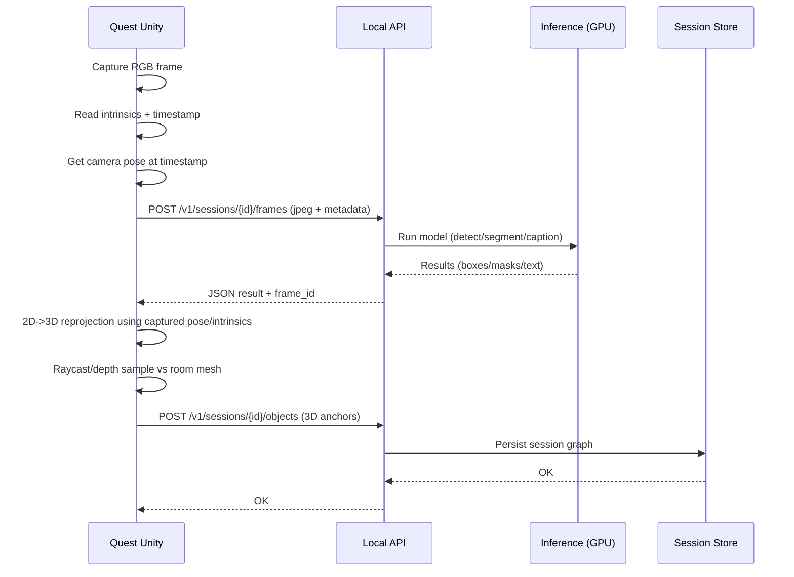

# Formal Software Development Plan
## Cross-Platform House Mapping System with Grounding DINO, Grounded-SAM 2 &amp; Florence-2

## Current Plan (Feb 22, 2026)

This repo is now focused on a Quest 3 local world/space mapper with glTF export and sync.

1) Run the local CV server in Docker (Grounding DINO, SAM 2, Florence-2).
2) Capture Quest frames and detect/segment/caption via the local server.
3) Capture Meta scene anchors and semantic labels from Space Setup.
4) Raycast detections into world space and track pins.
5) Export glTF with combined extras and upload back to the CV server.

The rest of this document is historical context from earlier iterations.

**Version:** 2.0  
**Date:** February 21, 2026  
**Author:** AI Architecture Assistant  
**Client Hardware:** Linux server with NVIDIA RTX 4080 (16 GB GDDR6X VRAM)[1][2]
**Target Platforms:** Meta Quest 3, iOS (ARKit), Android (ARCore)

***

## 1. Executive Summary

This plan extends the original Grounding DINO zero-shot detection server into a **multi-model computer vision pipeline** that supports three complementary model families behind a single FastAPI REST interface:

| Model | Purpose | Parameters | Approx. VRAM (FP16) |
|---|---|---|---|
| Grounding DINO (Swin-Tiny) | Open-vocabulary bounding-box detection | ~172M | ~2–4 GB [3][1] |
| SAM 2 (Hiera-Tiny) | Promptable pixel-level segmentation | ~38.9M | ~1–2 GB [4][5] |
| Florence-2-base | Unified vision-language (caption, detect, ground, OCR) | ~230M | ~0.7 GB [6] |
| Florence-2-large | Higher-accuracy variant | ~770M | ~1.2 GB [6][7] |

All three model families fit comfortably within the RTX 4080's 16 GB VRAM, even when loaded simultaneously. The Unity client is extended with mask-overlay rendering and richer annotation types while maintaining a single shared codebase across Quest 3, iOS, and Android via the `ICameraProvider` abstraction and `UnityWebRequest`.[8][2]

***

## 2. System Architecture Overview

```
┌──────────────────────────────────────────────────┐
│                 Unity Client (Shared)             │
│  ┌─────────────┐ ┌──────────┐ ┌───────────────┐  │
│  │ICameraProvider│ │CVServer  │ │AnnotationRenderer│
│  │(Quest/iOS/   │ │Client    │ │(Boxes + Masks │  │
│  │ Android)     │ │(HTTP)    │ │ + Labels)     │  │
│  └──────┬──────┘ └────┬─────┘ └───────┬───────┘  │
│         │ frames       │ JSON req/res   │ overlay  │
└─────────┼──────────────┼───────────────┼──────────┘
          │    WiFi 5GHz │               │
          ▼              ▼               │
┌──────────────────────────────────────────────────┐
│            Linux CV Server (RTX 4080)            │
│  ┌──────────────────────────────────────────┐    │
│  │           FastAPI + Uvicorn               │    │
│  │  ┌─────────┐ ┌────────┐ ┌────────────┐  │    │
│  │  │ /detect  │ │/segment│ │ /florence   │  │    │
│  │  │ (G-DINO) │ │(G-SAM2)│ │ (Flor-2)   │  │    │
│  │  └────┬────┘ └───┬────┘ └─────┬──────┘  │    │
│  │       │          │            │          │    │
│  │  ┌────▼──────────▼────────────▼───────┐  │    │
│  │  │        ModelManager (Singleton)     │  │    │
│  │  │  - Grounding DINO (Swin-T)         │  │    │
│  │  │  - SAM 2 (Hiera-Tiny/Base+)        │  │    │
│  │  │  - Florence-2 (base or large)      │  │    │
│  │  │  - GPU memory monitor              │  │    │
│  │  └────────────────────────────────────┘  │    │
│  └──────────────────────────────────────────┘    │
│  Docker (NVIDIA Container Toolkit, CUDA 12.x)    │
└──────────────────────────────────────────────────┘
```

***

## 3. Model Descriptions and Rationale

### 3.1 Grounding DINO (Retained from v1.0)

Grounding DINO remains the primary **open-vocabulary object detector**. It marries a Swin Transformer visual backbone with BERT-based text encoding through bidirectional cross-attention, enabling zero-shot detection of arbitrary objects described in natural language. The Swin-Tiny variant processes images at approximately 100–300 ms on consumer GPUs and occupies only 2–4 GB VRAM during inference.[3][1]

### 3.2 SAM 2 (Segment Anything Model 2)

SAM 2 extends the original SAM with a **memory-based streaming architecture** that enables both image segmentation and video object tracking. When paired with Grounding DINO in the Grounded-SAM 2 pipeline, the workflow is a cascade: Grounding DINO outputs bounding boxes, and SAM 2 converts each box into a precise pixel-level mask. This is critical for house mapping — knowing not just *where* an object is, but its *exact boundary* for accurate 3D reconstruction.[9][10][11]

Key architectural features relevant to this project:[4][11]
- **Promptable segmentation**: accepts box, point, or mask prompts from the detection stage
- **Memory bank**: maintains object state across frames via a FIFO queue, enabling temporal consistency
- **Model variants**: Tiny (38.9M params, ~47 FPS on A100), Small, Base+, and Large (225M params, ~30 FPS on A100)[4]
- **VRAM**: The Large checkpoint uses approximately 5 GB on GPU; the Tiny variant uses significantly less (~1–2 GB)[5]

For the RTX 4080 deployment, **SAM 2 Hiera-Tiny** is recommended for real-time use, with the option to upgrade to Hiera-Base+ for higher mask quality in batch/offline modes.

### 3.3 Florence-2

Florence-2 is Microsoft's unified vision-language model that converts diverse vision tasks into a single sequence-to-sequence format using text prompts. Unlike Grounding DINO (which only does detection), Florence-2 supports:[12][7]

- **Object detection** (`<OD>`)
- **Dense region captioning** (`<DENSE_REGION_CAPTION>`)
- **Phrase grounding** (`<CAPTION_TO_PHRASE_GROUNDING>`)
- **Open vocabulary detection** (`<OPEN_VOCABULARY_DETECTION>`)
- **OCR / text recognition**
- **Image captioning** (multiple granularities)[10]

This makes Florence-2 extremely valuable for house mapping: it can **auto-caption rooms** (describing what it sees), **read labels on items**, and serve as an **alternative grounding backbone** to Grounding DINO within the Grounded-SAM 2 pipeline.[9][10]

Florence-2-base (230M params) uses only ~658 MB VRAM; Florence-2-large (770M params) uses ~1.2 GB. Both are trivially small relative to the 4080's 16 GB budget.[6][2]

***

## 4. VRAM Budget (RTX 4080 — 16 GB)

| Component | Model Variant | Est. VRAM | Notes |
|---|---|---|---|
| Grounding DINO | Swin-Tiny + BERT-base | ~3.0 GB | Includes deformable attention buffers [3] |
| SAM 2 | Hiera-Tiny | ~1.5 GB | Image-only mode; video mode adds memory bank overhead [5][4] |
| Florence-2 | Large (0.77B) | ~1.2 GB | HuggingFace transformers, FP16 [6] |
| PyTorch/CUDA overhead | — | ~1.5 GB | Context, kernel cache, allocator fragmentation |
| **Total (all loaded)** | — | **~7.2 GB** | |
| **Remaining headroom** | — | **~8.8 GB** | Available for batch processing, larger SAM 2 variants, or future models |

This budget confirms all three models can be **loaded simultaneously** in GPU memory with substantial headroom. No model swapping or offloading is required.[2][1]

***

## 5. Server Implementation

### 5.1 Technology Stack

| Layer | Technology | Version |
|---|---|---|
| Container | Docker + NVIDIA Container Toolkit | Latest |
| Base Image | `nvidia/cuda:12.1.1-cudnn8-runtime-ubuntu22.04` | — |
| Runtime | Python 3.10+, PyTorch ≥ 2.3.1, CUDA 12.1 | [13] |
| Framework | FastAPI + Uvicorn | Latest |
| Models | Grounding DINO (IDEA-Research), SAM 2 (Meta), Florence-2 (Microsoft/HuggingFace) | [14][10][7] |

### 5.2 Project Structure

```
cv-server/
├── Dockerfile
├── docker-compose.yml
├── requirements.txt
├── app/
│   ├── main.py                 # FastAPI app, startup/shutdown
│   ├── config.py               # Environment variables, model paths, thresholds
│   ├── model_manager.py        # Singleton: loads/holds all models on GPU
│   ├── routers/
│   │   ├── detect.py           # /v1/detect  (Grounding DINO only)
│   │   ├── segment.py          # /v1/segment (Grounded-SAM 2 pipeline)
│   │   ├── florence.py         # /v1/florence (Florence-2 multi-task)
│   │   └── health.py           # /v1/health  (status, VRAM, latency)
│   ├── pipelines/
│   │   ├── grounding_dino.py   # Grounding DINO inference wrapper
│   │   ├── grounded_sam2.py    # G-DINO → SAM 2 cascade pipeline
│   │   ├── florence2.py        # Florence-2 task dispatcher
│   │   └── florence_sam2.py    # Florence-2 → SAM 2 cascade pipeline
│   ├── schemas/
│   │   ├── detect.py           # Pydantic models for detection requests/responses
│   │   ├── segment.py          # Pydantic models for segmentation (includes RLE masks)
│   │   └── florence.py         # Pydantic models for Florence-2 tasks
│   └── utils/
│       ├── image_utils.py      # Base64 decode, resize, tensor conversion
│       ├── mask_encoding.py    # RLE encode/decode, mask → polygon
│       └── gpu_monitor.py      # VRAM usage, temperature monitoring
├── checkpoints/
│   ├── groundingdino_swint_ogc.pth
│   ├── sam2.1_hiera_tiny.pt
│   └── (Florence-2 auto-downloaded from HuggingFace on first run)
├── configs/
│   ├── GroundingDINO_SwinT_OGC.py
│   └── sam2.1_hiera_t.yaml
└── tests/
    ├── test_detect.py
    ├── test_segment.py
    └── test_florence.py
```

### 5.3 Model Manager (Singleton)

```python
# app/model_manager.py (conceptual)
class ModelManager:
    _instance = None

    def __init__(self):
        self.device = torch.device("cuda" if torch.cuda.is_available() else "cpu")
        self.gdino_model = None
        self.sam2_predictor = None
        self.florence_model = None
        self.florence_processor = None

    @classmethod
    def get_instance(cls):
        if cls._instance is None:
            cls._instance = cls()
        return cls._instance

    def load_all(self):
        # 1. Grounding DINO
        self.gdino_model = load_model(
            "configs/GroundingDINO_SwinT_OGC.py",
            "checkpoints/groundingdino_swint_ogc.pth",
            device=self.device
        )
        # 2. SAM 2
        self.sam2_predictor = build_sam2(
            "configs/sam2.1_hiera_t.yaml",
            "checkpoints/sam2.1_hiera_tiny.pt",
            device=self.device
        )
        # 3. Florence-2
        self.florence_model = AutoModelForCausalLM.from_pretrained(
            "microsoft/Florence-2-large",
            torch_dtype=torch.float16,
            trust_remote_code=True
        ).to(self.device)
        self.florence_processor = AutoProcessor.from_pretrained(
            "microsoft/Florence-2-large",
            trust_remote_code=True
        )
        log_vram_usage()
```

All models load at FastAPI startup (`@app.on_event("startup")`) and persist for the lifetime of the container.[15]

### 5.4 API Endpoints

#### 5.4.1 Detection — `POST /v1/detect`

Performs Grounding DINO zero-shot detection (backward-compatible with the original plan).

**Request:**
```json
{
  "image": "<base64-encoded JPEG>",
  "prompt": "chair . table . lamp .",
  "box_threshold": 0.35,
  "text_threshold": 0.25
}
```

**Response:**
```json
{
  "bboxes": [[x1,y1,x2,y2], ...],
  "labels": ["chair", "table", ...],
  "scores": [0.87, 0.72, ...]
}
```

#### 5.4.2 Segmentation — `POST /v1/segment`

Runs the full Grounded-SAM 2 cascade: Grounding DINO detects → SAM 2 segments.

**Request:**
```json
{
  "image": "<base64-encoded JPEG>",
  "prompt": "couch . window . door .",
  "box_threshold": 0.35,
  "text_threshold": 0.25,
  "grounding_model": "grounding_dino",  // or "florence2"
  "return_masks": true,
  "mask_format": "rle"                  // "rle" | "polygon" | "base64_png"
}
```

**Response:**
```json
{
  "annotations": [
    {
      "label": "couch",
      "score": 0.91,
      "bbox": [120, 200, 450, 480],
      "mask": {
        "size": [720, 1280],
        "counts": "<RLE-encoded string>"
      }
    }
  ],
  "image_size": [720, 1280]
}
```

The `grounding_model` parameter allows the client to choose between Grounding DINO and Florence-2 as the detection backbone for the SAM 2 cascade. This is a key extensibility point — the Grounded-SAM 2 repo explicitly supports swapping in Florence-2 for detection.[10][9]

#### 5.4.3 Florence-2 Multi-Task — `POST /v1/florence`

Exposes Florence-2's full range of vision-language capabilities.

**Request:**
```json
{
  "image": "<base64-encoded JPEG>",
  "task": "<DENSE_REGION_CAPTION>",
  "text_input": ""  // optional, required for phrase grounding / open vocab
}
```

**Supported tasks** (maps directly to Florence-2 task prompts):[10]

| Task Prompt | Requires Text Input | Description |
|---|---|---|
| `<OD>` | No | Object detection with single category names |
| `<DENSE_REGION_CAPTION>` | No | Detect objects with short descriptions |
| `<REGION_PROPOSAL>` | No | Generate bounding box proposals |
| `<CAPTION>` | No | Image caption |
| `<DETAILED_CAPTION>` | No | Detailed image caption |
| `<MORE_DETAILED_CAPTION>` | No | Highly detailed image caption |
| `<CAPTION_TO_PHRASE_GROUNDING>` | Yes | Ground phrases from caption in image |
| `<OPEN_VOCABULARY_DETECTION>` | Yes | Detect objects by arbitrary text |
| `<OCR>` | No | Optical character recognition |

**Response** (varies by task, example for `<DENSE_REGION_CAPTION>`):
```json
{
  "task": "<DENSE_REGION_CAPTION>",
  "results": {
    "labels": ["a wooden dining table", "a blue cushion chair", ...],
    "bboxes": [[100, 150, 400, 350], ...]
  }
}
```

#### 5.4.4 Health — `GET /v1/health`

```json
{
  "status": "ok",
  "gpu": "NVIDIA RTX 4080",
  "vram_used_mb": 7200,
  "vram_total_mb": 16384,
  "models_loaded": ["grounding_dino", "sam2", "florence2"],
  "uptime_seconds": 86400
}
```

### 5.5 Grounded-SAM 2 Pipeline Implementation

The core cascade logic follows the architecture documented in the Grounded-SAM 2 repository:[9][10]

```python
# app/pipelines/grounded_sam2.py (conceptual)
def grounded_sam2_inference(image, prompt, box_threshold, text_threshold,
                            grounding_model="grounding_dino"):
    mm = ModelManager.get_instance()

    # Step 1: Grounding (choose backbone)
    if grounding_model == "grounding_dino":
        boxes, labels, scores = gdino_predict(
            mm.gdino_model, image, prompt, box_threshold, text_threshold
        )
    elif grounding_model == "florence2":
        boxes, labels, scores = florence2_detect(
            mm.florence_model, mm.florence_processor, image, prompt
        )

    # Step 2: SAM 2 segmentation from box prompts
    mm.sam2_predictor.set_image(image_np)
    masks = []
    for box in boxes:
        mask, score, _ = mm.sam2_predictor.predict(
            box=box,
            multimask_output=False
        )
        masks.append(rle_encode(mask))

    return annotations  # boxes + labels + scores + RLE masks
```

This follows the exact pattern used in `grounded_sam2_local_demo.py` and `grounded_sam2_florence2_image_demo.py` from the official repo.[10]

### 5.6 Dockerfile

```dockerfile
FROM nvidia/cuda:12.1.1-cudnn8-devel-ubuntu22.04

ENV DEBIAN_FRONTEND=noninteractive
ENV PYTHONUNBUFFERED=1
ENV CUDA_HOME=/usr/local/cuda

RUN apt-get update && apt-get install -y \
    python3.10 python3-pip git build-essential \
    && rm -rf /var/lib/apt/lists/*

WORKDIR /app

# Install PyTorch with CUDA 12.1
RUN pip3 install torch torchvision torchaudio --index-url https://download.pytorch.org/whl/cu121

# Install Grounding DINO dependencies
COPY requirements.txt .
RUN pip3 install --no-cache-dir -r requirements.txt

# Install SAM 2 from source (requires CUDA compilation)
RUN git clone https://github.com/facebookresearch/sam2.git /tmp/sam2 \
    && cd /tmp/sam2 && pip3 install -e . \
    && rm -rf /tmp/sam2/.git

# Install Grounding DINO from source
RUN git clone https://github.com/IDEA-Research/GroundingDINO.git /tmp/gdino \
    && cd /tmp/gdino && pip3 install --no-build-isolation -e . \
    && rm -rf /tmp/gdino/.git

# Install Florence-2 dependencies
RUN pip3 install transformers accelerate einops timm

# Copy application code and checkpoints
COPY app/ /app/app/
COPY configs/ /app/configs/
COPY checkpoints/ /app/checkpoints/

EXPOSE 8000

CMD ["uvicorn", "app.main:app", "--host", "0.0.0.0", "--port", "8000"]
```

**docker-compose.yml:**
```yaml
version: "3.8"
services:
  cv-server:
    build: .
    runtime: nvidia
    environment:
      - NVIDIA_VISIBLE_DEVICES=all
    ports:
      - "8000:8000"
    volumes:
      - ./checkpoints:/app/checkpoints
      - huggingface_cache:/root/.cache/huggingface
    deploy:
      resources:
        reservations:
          devices:
            - driver: nvidia
              count: 1
              capabilities: [gpu]
    restart: unless-stopped

volumes:
  huggingface_cache:
```

### 5.7 Network Configuration

- **Server static LAN IP:** e.g., `192.168.1.100`
- **Port:** `8000`
- **WiFi:** 5 GHz band required for Quest 3 to minimize latency
- **Firewall:** Allow TCP 8000 inbound from LAN only
- **mDNS (optional):** Avahi service for `cv-server.local` discovery

***

## 6. Unity Client Architecture

### 6.1 Shared Codebase Strategy

The Unity project maintains a **single C# codebase** that compiles for all three targets. Platform differences are isolated behind interfaces:[16][8]

```
Assets/
├── HouseMapper/
│   ├── Core/
│   │   ├── ICameraProvider.cs          # Interface for camera frame capture
│   │   ├── CVServerClient.cs           # HTTP client (UnityWebRequest)
│   │   ├── DetectionResult.cs          # Shared data models
│   │   ├── SegmentationResult.cs       # Mask data model (new)
│   │   ├── FlorenceResult.cs           # Florence-2 response model (new)
│   │   └── ServerConfig.cs             # Server URL, thresholds
│   ├── Platform/
│   │   ├── QuestCameraProvider.cs      # WebCamTexture via Passthrough Camera API
│   │   ├── MobileCameraProvider.cs     # ARFoundation camera image
│   │   └── DesktopCameraProvider.cs    # WebCamTexture (testing)
│   ├── Rendering/
│   │   ├── BBoxRenderer.cs             # 3D bounding box overlay (retained)
│   │   ├── MaskRenderer.cs             # Segmentation mask overlay (new)
│   │   ├── LabelRenderer.cs            # Floating text labels (new)
│   │   └── CaptionPanel.cs             # Room description UI (new, Florence)
│   ├── Mapping/
│   │   ├── ObjectMapper.cs             # 2D→3D projection + scene graph
│   │   ├── RoomAnalyzer.cs             # Florence-2 auto-captioning per room (new)
│   │   └── MappedObjectDatabase.cs     # Persistent object storage
│   ├── UI/
│   │   ├── PromptInputUI.cs            # Text prompt entry
│   │   ├── ModelSelectorUI.cs          # Choose detect/segment/florence (new)
│   │   ├── MaskToggleUI.cs             # Show/hide segmentation overlays (new)
│   │   └── SettingsPanel.cs            # Server config, thresholds
│   ├── Prefabs/
│   ├── Scenes/
│   └── Editor/
```

### 6.2 Extended CVServerClient

The HTTP client class expands from a single detection call to support all three server endpoints:

```csharp
public class CVServerClient
{
    private string baseUrl;  // e.g., "http://192.168.1.100:8000"

    // === DETECTION (Grounding DINO only) ===
    public async Task<DetectionResult> DetectAsync(
        byte[] jpegBytes, string prompt,
        float boxThreshold = 0.35f, float textThreshold = 0.25f)
    {
        var payload = new DetectRequest {
            image = Convert.ToBase64String(jpegBytes),
            prompt = prompt,
            box_threshold = boxThreshold,
            text_threshold = textThreshold
        };
        return await PostAsync<DetectionResult>("/v1/detect", payload);
    }

    // === SEGMENTATION (Grounded-SAM 2) ===
    public async Task<SegmentationResult> SegmentAsync(
        byte[] jpegBytes, string prompt,
        string groundingModel = "grounding_dino",
        string maskFormat = "rle")
    {
        var payload = new SegmentRequest {
            image = Convert.ToBase64String(jpegBytes),
            prompt = prompt,
            grounding_model = groundingModel,
            return_masks = true,
            mask_format = maskFormat
        };
        return await PostAsync<SegmentationResult>("/v1/segment", payload);
    }

    // === FLORENCE-2 (Multi-task) ===
    public async Task<FlorenceResult> FlorenceAsync(
        byte[] jpegBytes, string task, string textInput = "")
    {
        var payload = new FlorenceRequest {
            image = Convert.ToBase64String(jpegBytes),
            task = task,
            text_input = textInput
        };
        return await PostAsync<FlorenceResult>("/v1/florence", payload);
    }

    // Shared HTTP transport using UnityWebRequest
    private async Task<T> PostAsync<T>(string endpoint, object payload) { ... }
}
```

`UnityWebRequest` is used as the underlying HTTP transport because it works identically across Quest 3, iOS, and Android with no platform-specific code.[8]

### 6.3 Mask Rendering (New Component)

For segmentation results, the client must render pixel-accurate mask overlays on the camera feed. The approach:

1. **Server returns RLE-encoded masks** per detected object
2. **Client decodes RLE → Texture2D** (C# RLE decoder, runs on CPU in ~1–2 ms)
3. **Mask rendered as semi-transparent quad** in camera-aligned space with per-object color coding
4. **Quest 3**: Quad overlaid in passthrough space using MRUK raycasting for depth-correct placement
5. **iOS/Android**: Quad overlaid on ARFoundation camera background using screen-space projection

```csharp
public class MaskRenderer : MonoBehaviour
{
    [SerializeField] private Material maskMaterial;  // Unlit, alpha-blended
    private static readonly Color[] palette = { /* 20 distinct colors */ };

    public void RenderMasks(SegmentationResult result, Camera cam)
    {
        ClearPreviousMasks();
        for (int i = 0; i < result.annotations.Length; i++)
        {
            var ann = result.annotations[i];
            Texture2D maskTex = RLEDecoder.Decode(ann.mask, result.image_size);
            Color color = palette[i % palette.Length];
            color.a = 0.4f;  // 40% opacity

            // Create screen-aligned quad with mask texture
            var quad = CreateMaskQuad(maskTex, color, cam);
            quad.name = $"Mask_{ann.label}_{i}";
        }
    }
}
```

### 6.4 Room Analysis Flow (Florence-2 Integration)

A new **RoomAnalyzer** component uses Florence-2's captioning capability to automatically describe rooms:

```
User enters room → QuestCameraProvider captures frame
    → RoomAnalyzer sends to /v1/florence with <MORE_DETAILED_CAPTION>
    → Server returns natural language description
    → CaptionPanel displays: "A living room with a brown leather sofa,
       a glass coffee table, two floor lamps, and a mounted TV on
       the east wall."
    → Optionally: cascade caption → phrase grounding → SAM 2
       for fully automatic room inventory
```

This enables a **zero-prompt mapping mode** where the user simply walks through the house and Florence-2 automatically identifies and labels everything it sees.[7][10]

### 6.5 Platform-Specific Camera Implementations

| Platform | Camera Source | Resolution | Notes |
|---|---|---|---|
| Quest 3 | WebCamTexture via Passthrough Camera API | Up to 1280×960 @ ~30 fps | Requires HorizonOS v74+, `horizonos.permission.HEADSET_CAMERA` [16][17] |
| iOS | ARFoundation `XRCpuImage` | Device-dependent (typically 1920×1080) | Uses ARKit pose for 3D projection |
| Android | ARFoundation `XRCpuImage` | Device-dependent | Uses ARCore pose for 3D projection |

The `ICameraProvider` interface remains unchanged from v1.0:

```csharp
public interface ICameraProvider
{
    bool IsAvailable { get; }
    void StartCapture();
    void StopCapture();
    byte[] GetCurrentFrameJPEG(int quality = 75);
    Matrix4x4 GetCameraIntrinsics();
    Pose GetCameraPose();
}
```

***

## 7. Data Flow — Three Operating Modes

### Mode 1: Detection Only (Fast Scan)
```
Camera Frame → JPEG encode → /v1/detect → bounding boxes + labels
→ 3D placement via raycasting → BBoxRenderer overlays
```
**Latency:** ~150–350 ms round-trip  
**Use Case:** Quick room survey, counting objects

### Mode 2: Detection + Segmentation (Precise Mapping)
```
Camera Frame → JPEG encode → /v1/segment → boxes + masks + labels
→ MaskRenderer overlays + ObjectMapper 3D placement
```
**Latency:** ~300–600 ms round-trip  
**Use Case:** Accurate object boundaries for 3D reconstruction

### Mode 3: Auto-Captioning (Hands-Free Inventory)
```
Camera Frame → JPEG encode → /v1/florence (caption)
→ Caption text → /v1/florence (phrase grounding)
→ Grounded boxes → /v1/segment (SAM 2 refinement)
→ Full inventory with descriptions + masks
```
**Latency:** ~800–1500 ms (3-step cascade)  
**Use Case:** Comprehensive room documentation, automatic floor-plan annotation

***

## 8. Development Roadmap (8-Week Sprint Plan)

### Phase 1: Server Foundation (Weeks 1–2)

**Sprint 1 (Week 1): Core Server + Grounding DINO**

| Task | Est. Hours | Deliverable |
|---|---|---|
| Set up Docker environment with CUDA 12.1 | 4 | Working container with GPU passthrough |
| Implement `ModelManager` singleton (GDINO only) | 6 | Model loads on startup, VRAM verified |
| Implement `/v1/detect` endpoint | 6 | Parity with original NVIDIA API format |
| Implement `/v1/health` endpoint | 2 | Status, VRAM, uptime reporting |
| Unit tests for detection pipeline | 4 | pytest suite with sample images |
| **Sprint 1 Total** | **22** | |

**Sprint 2 (Week 2): SAM 2 + Florence-2 Integration**

| Task | Est. Hours | Deliverable |
|---|---|---|
| Add SAM 2 to `ModelManager` (build CUDA extension) | 6 | SAM 2 loads alongside GDINO [13] |
| Implement Grounded-SAM 2 cascade pipeline | 8 | `/v1/segment` with RLE mask output |
| Add Florence-2 to `ModelManager` | 4 | HuggingFace model loads, FP16 [7] |
| Implement `/v1/florence` multi-task endpoint | 6 | All task prompts supported [10] |
| Implement Florence-2 → SAM 2 cascade variant | 4 | `grounding_model=florence2` in `/v1/segment` |
| RLE encoding/decoding utilities | 3 | Tested encode/decode round-trip |
| Integration tests for all endpoints | 4 | Full test coverage |
| **Sprint 2 Total** | **35** | |

### Phase 2: Unity Client Core (Weeks 3–4)

**Sprint 3 (Week 3): Shared Client Architecture**

| Task | Est. Hours | Deliverable |
|---|---|---|
| Fork `Unity-MetaXR-AI-ZeroShot` repository | 2 | Clean project with Meta XR SDK |
| Implement `ICameraProvider` interface + Quest impl | 8 | `QuestCameraProvider` with WebCamTexture [16] |
| Implement `CVServerClient` (all 3 endpoints) | 8 | Detection, segmentation, Florence calls |
| Implement `DetectionResult`, `SegmentationResult`, `FlorenceResult` models | 4 | JSON deserialization from server |
| Implement RLE decoder in C# | 4 | Converts server masks to Texture2D |
| `BBoxRenderer` (retained + enhanced) | 4 | 3D box overlays with labels |
| **Sprint 3 Total** | **30** | |

**Sprint 4 (Week 4): Mask Rendering + Florence UI**

| Task | Est. Hours | Deliverable |
|---|---|---|
| `MaskRenderer` — segmentation overlay system | 10 | Color-coded transparent mask quads |
| `LabelRenderer` — floating text labels | 4 | World-space TextMeshPro labels |
| `CaptionPanel` — Florence-2 room description UI | 4 | HUD panel showing auto-captions |
| `ModelSelectorUI` — mode toggle (detect/segment/caption) | 4 | Runtime mode switching |
| `PromptInputUI` — text prompt entry | 4 | Virtual keyboard + presets |
| End-to-end Quest 3 integration test | 6 | Detection + segmentation working on Quest |
| **Sprint 4 Total** | **32** | |

### Phase 3: Cross-Platform + 3D Mapping (Weeks 5–6)

**Sprint 5 (Week 5): iOS/Android + Mapping**

| Task | Est. Hours | Deliverable |
|---|---|---|
| `MobileCameraProvider` (ARFoundation) | 8 | XRCpuImage capture for iOS/Android |
| ARFoundation raycasting for 3D placement | 6 | Boxes/masks projected into AR world |
| `ObjectMapper` — persistent scene graph | 8 | Deduplicate detections, build world map |
| iOS build configuration + testing | 4 | XCode build, device test |
| Android build configuration + testing | 4 | APK build, device test |
| **Sprint 5 Total** | **30** | |

**Sprint 6 (Week 6): Advanced Mapping Features**

| Task | Est. Hours | Deliverable |
|---|---|---|
| `RoomAnalyzer` — auto-captioning pipeline | 8 | Walk-through auto-inventory mode |
| `MappedObjectDatabase` — persistent storage | 6 | JSON/SQLite export of mapped objects |
| Multi-frame deduplication + temporal smoothing | 6 | Stable object tracking across frames |
| Floor plan export (2D top-down view) | 8 | PNG/SVG floor plan with labeled objects |
| **Sprint 6 Total** | **28** | |

### Phase 4: Polish + Optimization (Weeks 7–8)

**Sprint 7 (Week 7): Performance Optimization**

| Task | Est. Hours | Deliverable |
|---|---|---|
| Server: batch inference for multiple frames | 6 | Higher throughput for walk-through mode |
| Server: JPEG quality/resolution negotiation | 4 | Client sends resolution preference |
| Client: frame skip + adaptive rate throttling | 6 | Send frames only when movement detected |
| Client: async mask rendering (background thread) | 6 | No main-thread hitching during decode |
| WebSocket upgrade for streaming mode (optional) | 8 | Lower latency via persistent connection [18] |
| **Sprint 7 Total** | **30** | |

**Sprint 8 (Week 8): Testing + Documentation**

| Task | Est. Hours | Deliverable |
|---|---|---|
| End-to-end testing on all 3 platforms | 12 | Quest 3, iPhone, Android device tests |
| Latency profiling + optimization | 6 | Target &lt;500 ms for detection, &lt;800 ms for segmentation |
| User documentation / README | 4 | Setup guide, API docs, troubleshooting |
| Server monitoring dashboard (optional Grafana) | 4 | VRAM, latency, request count metrics |
| Final code review + cleanup | 4 | Production-ready codebase |
| **Sprint 8 Total** | **30** | |

**Total Estimated Effort: ~237 hours across 8 weeks**

***

## 9. Testing Strategy

### 9.1 Server Testing

| Level | Tool | Scope |
|---|---|---|
| Unit | pytest | Individual model inference, image encoding, RLE codec |
| Integration | pytest + httpx | Full endpoint round-trips against running server |
| Load | Locust or k6 | Sustained requests to measure throughput + VRAM stability |
| Smoke | curl scripts | Quick sanity check for CI/CD |

**Key test cases:**
- Grounding DINO detects known objects (chair, table, door) with score > 0.5
- Grounded-SAM 2 returns valid RLE masks that decode to correct dimensions
- Florence-2 + SAM 2 cascade produces same masks as Grounding DINO + SAM 2 for equivalent prompts
- All three models loaded simultaneously stay under 10 GB VRAM
- 100 sequential requests don't cause VRAM growth (leak detection)[19]
- Server returns `503 Unavailable` if GPU is unreachable

### 9.2 Client Testing

| Level | Method | Scope |
|---|---|---|
| Unit | Unity Test Framework | RLE decoder, JSON parsers, data models |
| Integration | In-editor play mode | CVServerClient against local server |
| Device | Manual | Quest 3, iPhone, Android real-device walkthrough |
| Regression | Screenshot comparison | Mask overlay accuracy across builds |

***

## 10. Risk Register

| Risk | Likelihood | Impact | Mitigation |
|---|---|---|---|
| SAM 2 VRAM leak on long video streams | Medium | High | Use image-mode predictor (not video); call `torch.cuda.empty_cache()` between requests [20][19] |
| Grounding DINO deformable attention CUDA build fails | Medium | High | Pre-build in Docker with pinned CUDA 12.1 + PyTorch 2.3.1 [13] |
| Florence-2 HuggingFace download fails at container start | Low | Medium | Pre-download weights into volume mount; set `HF_HUB_OFFLINE=1` |
| Quest 3 Passthrough Camera API latency too high | Low | Medium | Use 640×480 resolution; send every 3rd frame; pre-compress JPEG quality 60 [17] |
| Three models exceed 16 GB VRAM simultaneously | Very Low | High | Budget shows ~7.2 GB total — 55% headroom; can drop to Florence-2-base if needed [6] |
| WebCamTexture permission denied on Quest | Medium | Medium | Implement graceful fallback UI; check `horizonos.permission.HEADSET_CAMERA` at runtime [16] |
| Cross-platform JSON serialization inconsistencies | Low | Low | Use `JsonUtility` for simple types; Newtonsoft.Json for complex (RLE masks) |
| Network unreachable (server offline) | Medium | Medium | Client caches last known detections; offline mode with local Sentis fallback |

***

## 11. Advanced Considerations

### 11.1 Model Hot-Swapping

For future flexibility, the `ModelManager` can support **dynamic model loading/unloading** via an admin endpoint:

```
POST /v1/admin/models
{
  "action": "load",
  "model": "sam2_hiera_large"
}
```

This allows upgrading from SAM 2 Tiny to SAM 2 Large for higher-quality masks when latency is less critical (e.g., batch processing overnight).

### 11.2 Streaming / WebSocket Mode

For continuous walk-through mapping, a WebSocket endpoint provides lower latency than repeated HTTP POST cycles:[18]

```
ws://192.168.1.100:8000/v1/stream
```

Client sends JPEG frames continuously; server responds with JSON annotations per frame. The NativeWebSocket Unity library supports this across all platforms.[18]

### 11.3 Unity Sentis Fallback

For offline/portable use, lighter models can run directly on-device using Unity Sentis (ONNX runtime). This provides degraded but functional detection when the server is unreachable. Florence-2-base (230M params) is particularly promising for on-device deployment given its small size.[7]

### 11.4 SAM 2 Video Tracking Mode

For continuous object tracking during house walk-throughs, SAM 2's video predictor mode can propagate masks across frames using its memory bank. However, this requires careful VRAM management — the memory bank grows with each frame. For the RTX 4080, limit the memory bank to ~50 recent frames and use `offload_video_to_cpu=True` for longer sequences.[11][20][10]

### 11.5 Floor Plan Generation Pipeline

A complete house mapping session produces:

1. **Object inventory** (JSON): all detected objects with labels, bounding boxes, masks, 3D positions, and room assignments
2. **Room descriptions** (text): Florence-2 auto-generated captions per room
3. **Floor plan** (SVG/PNG): top-down 2D projection of mapped objects
4. **3D scene graph** (JSON): spatial relationships between objects

***

## 12. Security Considerations

| Concern | Mitigation |
|---|---|
| Server exposed on LAN | Bind to LAN IP only; firewall blocks WAN access; optional API key header |
| Camera frames contain private data | All processing is local; no data leaves the home network; Docker volumes use host filesystem |
| Model weights licensing | Grounding DINO (Apache 2.0), SAM 2 (Apache 2.0), Florence-2 (MIT) — all permissive for private use [10][7] |
| Docker container privilege escalation | Run as non-root user inside container; limit GPU device access |

***

## 13. Dependencies and Versions

| Dependency | Version | Source |
|---|---|---|
| Python | 3.10+ | System |
| PyTorch | ≥ 2.3.1 | pytorch.org |
| CUDA Toolkit | 12.1 | NVIDIA |
| FastAPI | Latest | PyPI |
| Uvicorn | Latest | PyPI |
| Grounding DINO | Main branch | github.com/IDEA-Research/GroundingDINO [14] |
| SAM 2 | v2.1 | github.com/facebookresearch/sam2 |
| Grounded-SAM 2 | Main branch | github.com/IDEA-Research/Grounded-SAM-2 [10] |
| Florence-2 | Large (0.77B) | huggingface.co/microsoft/Florence-2-large [7] |
| HuggingFace Transformers | Latest | PyPI |
| Unity | 6.x (LTS) | Unity Hub |
| Meta XR SDK | Latest | Unity Asset Store |
| ARFoundation | 6.x | Unity Package Manager |
| NativeWebSocket | Latest | github.com/endel/NativeWebSocket [18] |

***

## 14. Reference Repositories

| Repository | Purpose |
|---|---|
| [IDEA-Research/Grounded-SAM-2](https://github.com/IDEA-Research/Grounded-SAM-2) [10] | Official Grounded-SAM 2 with Florence-2 demos, Docker support |
| [IDEA-Research/GroundingDINO](https://github.com/IDEA-Research/GroundingDINO) [14] | Grounding DINO model and weights |
| [facebookresearch/sam2](https://github.com/facebookresearch/sam2) | SAM 2 model, checkpoints, CUDA extension |
| [lucas-martinic/Unity-MetaXR-AI-ZeroShot](https://github.com/lucas-martinic/Unity-MetaXR-AI-ZeroShot) | Base Unity project to fork |
| [xrdevrob/QuestCameraKit](https://github.com/xrdevrob/QuestCameraKit) [17] | Quest 3 camera access reference patterns |
| [oculus-samples/Unity-PassthroughCameraApiSamples](https://github.com/oculus-samples/Unity-PassthroughCameraApiSamples) [16] | Official Meta Quest camera samples |
| [edgarwelteKIT/groundingdino_localapi](https://github.com/edgarwelteKIT/groundingdino_localapi) [21] | Docker REST API reference for Grounding DINO |
| [endel/NativeWebSocket](https://github.com/endel/NativeWebSocket) [18] | Cross-platform WebSocket for Unity |

***

## 15. Glossary

| Term | Definition |
|---|---|
| **Grounding DINO** | Open-vocabulary object detector using vision-language cross-attention [3] |
| **SAM 2** | Segment Anything Model 2 — promptable image/video segmentation from Meta [11] |
| **Grounded-SAM 2** | Pipeline cascading a grounding detector (GDINO/Florence-2) with SAM 2 [9][10] |
| **Florence-2** | Microsoft's unified vision-language model supporting detection, captioning, OCR, and grounding [12][7] |
| **RLE** | Run-Length Encoding — compact binary mask representation |
| **MRUK** | Meta Room Understanding Kit — Quest 3 spatial understanding for raycasting |
| **ICameraProvider** | Unity interface abstracting platform-specific camera access |
| **Passthrough Camera API** | Quest 3 API providing access to headset front cameras [16][17] |


# ALT VERSION

# Formal Software Development Plan for Local Quest 3 House Mapping With On‑Prem Vision Models

## Executive summary

You want to evolve the prototype concept demonstrated by `Unity-MetaXR-AI-ZeroShot` (Quest camera frame → zero-shot vision → 2D boxes → 3D anchors) into a **fully local**, privacy-preserving system that runs **entirely on your home network**: Unity clients on **Quest / iOS / Android**, backed by a **Linux CV server with an RTX 4080** that hosts **GroundingDINO**, **Grounded‑SAM** (GroundingDINO + Segment Anything), and **Florence‑2**. The key architectural shift is to **replace NVIDIA’s cloud “asset upload + polling” flow** with a low-latency **LAN inference API** designed for **timestamped pose correctness** (to avoid drift) and **session graph storage** (to make “mapping” durable and editable across devices). The project will succeed if it produces a measurable, repeatable scanning workflow: a Quest user can scan a room, see stable 3D semantic anchors (e.g., “door,” “couch”), export room geometry + a semantic object graph, and then review/edit it from a mobile app—without any cloud dependency.

Primary source anchors you should use while implementing:
- The baseline Unity project you referenced (cloud flow + UI/anchoring patterns): https://github.com/lucas-martinic/Unity-MetaXR-AI-ZeroShot/
- Meta Quest Passthrough Camera API samples: https://github.com/oculus-samples/Unity-PassthroughCameraApiSamples
- MRUK PassthroughCameraAccess API reference (timestamped pose + intrinsics): https://developers.meta.com/horizon/reference/mruk/v81/class_meta_x_r_passthrough_camera_access/
- Unity AR Foundation docs (shared mobile AR abstraction): https://docs.unity3d.com/Packages/com.unity.xr.arfoundation@latest/
- GroundingDINO repo (license/implementation): https://github.com/IDEA-Research/GroundingDINO
- Grounded‑SAM paper (design intent: text-to-mask via detection+segmentation): https://arxiv.org/abs/2401.14159
- Segment Anything (SAM) repo (license/weights): https://github.com/facebookresearch/segment-anything
- Florence‑2 model card/license (Hugging Face): https://huggingface.co/microsoft/Florence-2-large (see LICENSE on the repo page)
- Triton Inference Server docs (HTTP/gRPC, backends, model repo): https://docs.nvidia.com/deeplearning/triton-inference-server/user-guide/docs/index.html
- NVIDIA Container Toolkit (GPU in Docker): https://docs.nvidia.com/datacenter/cloud-native/container-toolkit/latest/

## Project goals and success criteria

### Project goals
Build a **local-first semantic mapping system** that:
- Captures Quest 3 passthrough frames + spatial context (intrinsics + timestamped pose + depth/mesh) and runs local GPU vision to detect/segment objects from text prompts.
- Anchors results as stable 3D entities in a room coordinate frame and persists them as a session graph.
- Shares the map across platforms via a single local API so **iOS/Android** apps can browse/edit the same map.
- Provides a clear path from a fast PyTorch MVP to optimized inference (ONNX/TensorRT/Triton).

### Success criteria (measurable)
Define “done” as hitting these thresholds in a representative home environment:

**Functional**
- Quest scan session can: (1) capture frames, (2) run detection, (3) place 3D anchors, (4) persist session, (5) re-load session later on Quest and on mobile.
- Server supports 3 task families: open-vocab detection (GroundingDINO), text-conditioned segmentation (Grounded‑SAM), multi-task vision-language (Florence‑2).

**Quality**
- Anchor stability: median 3D reprojection drift < 10 cm when the user turns head after capture (achieved by using pose *at capture timestamp* vs “current pose”).
- Detection responsiveness: median end-to-end latency (capture→server→response) < 400 ms on LAN at 1 FPS sampling (MVP); < 200 ms after optimization on selected models/inputs.
- Availability: server can recover automatically (systemd) and resumes serving within 60 seconds after reboot.

**Privacy/compliance**
- All processing stays on LAN; no remote endpoints.
- Quest app gates headset camera usage behind explicit user action and visible UI indicators; permission requests are explained in-app.

### Explicit assumptions
Because you stated “no specific constraint,” this plan assumes:
- Team size: 1–3 engineers (you as owner + optional support).
- Home network: standard Wi‑Fi 6/E and gigabit Ethernet to server.
- Storage: at least 1 TB available on the server for sessions (frames + exports).
- You can accept “developer mode” distributions during development; store submission is later.

## Detailed architecture and data flows

### Component architecture
Core idea: **Quest does sensing + spatial understanding**, server does **inference + persistence**, mobile does **review/edit + optional AR view**.

```mermaid
flowchart LR
  subgraph Clients
    Q[Quest 3 Unity App\nScanner + Anchoring]
    M[iOS/Android Unity App\nViewer/Editor (+ optional AR overlay)]
  end

  subgraph Server[Linux CV Server (RTX 4080)]
    GW[API Gateway\nHTTP/gRPC + Auth + Rate limits]
    INF[Inference Service\nGroundingDINO / Grounded-SAM / Florence-2]
    STORE[Session Store\nDB + Object Storage]
    IDX[Optional: Vector Index\nfor retrieval/dedup]
  end

  Q -- Frames+metadata --> GW
  M -- Query/edit --> GW
  GW --> INF
  GW --> STORE
  INF --> GW
  STORE --> GW
```

### End-to-end sequence: capture → inference → anchoring
Your biggest technical risk is **pose drift** caused by latency. The mitigation is to treat every frame as a packet: `(rgb, intrinsics, pose_at_timestamp, timestamp)`.



### Data flow principles
- **Capture-once, compute-many**: store a small set of keyframes for replayable testing and for re-running improved models.
- **Server returns pixel-space outputs** (boxes/masks aligned to the shipped image) to keep clients simple.
- **Clients own world anchoring** because they have the spatial map, depth, and XR coordinate frames.

image_group{"layout":"carousel","aspect_ratio":"16:9","query":["Meta Quest Passthrough Camera API Unity sample","MRUK scene room mesh Quest developer documentation image","NVIDIA Triton Inference Server architecture diagram","Grounded SAM example segmentation output"],"num_per_query":1}

## API design

### Design goals
- Low-latency LAN friendly
- Supports batching and asynchronous jobs when needed
- Stable schemas across Unity platforms
- Explicit error model, rate limits, and versioning
- Optional “compatibility mode” to emulate the cloud response shape used by the existing repo

### Authentication and transport
**MVP recommendation**
- HTTP/1.1 + JSON for simplicity, upgrade later.
- TLS on LAN (recommended, not strictly required for first internal prototype).
- Auth: pre-shared API token per device (Quest/mobile). Store devices in server config.

**Hardening trajectory**
- mTLS or device-bound tokens if you later want stronger LAN security.
- Use a local CA that your phone trusts (or a dev-only self-signed cert with explicit client trust handling).

### Error handling standard
Use a consistent JSON error envelope:

```json
{
  "error": {
    "code": "invalid_request",
    "message": "prompt must be non-empty",
    "details": { "field": "prompt" },
    "request_id": "01HZW..."
  }
}
```

Include:
- `request_id` for logs
- `retry_after_ms` for throttling
- HTTP status aligned with semantics (400/401/403/404/409/422/429/500/503)

### Rate limits
Rate limiting protects GPU memory and prevents clients from saturating LAN.

Baseline:
- Per-device: 2 requests/sec sustained, burst 5.
- Per-session: 1 in-flight inference request by default (configurable).
- Server: queue depth cap (e.g., 32), reject with `429` or `503` when exceeded.

### API endpoints table (requested)
This table uses concise “schema sketches.” The detailed JSON Schema files should live in your repo (`/contracts/openapi.yaml` + `/contracts/schemas/*.json`).

| Area | Method | Endpoint | Request schema (sketch) | Response schema (sketch) | Common errors |
|---|---:|---|---|---|---|
| Health | GET | `/v1/health` | — | `{status, version, gpu:{name, vram_mb}, models:[...]}` | 503 |
| Sessions | POST | `/v1/sessions` | `{device_id, client_version, notes?}` | `{session_id, created_at}` | 400, 401 |
| Sessions | GET | `/v1/sessions/{id}` | — | `{session_id, state, stats, created_at}` | 404 |
| Frames upload | POST | `/v1/sessions/{id}/frames` | `multipart`: `jpeg` + `meta_json` | `{frame_id, width, height, received_at}` | 400, 413, 415, 429 |
| Detect (sync) | POST | `/v1/detect` | `{image:{b64_jpeg}, prompt, threshold?, model_version?, return_logits?}` | `{detections:[{label, score, bbox_xywh_px}]}` | 400, 422, 429, 503 |
| Grounded‑SAM (sync) | POST | `/v1/segment` | `{image:{b64_jpeg}, prompt, dino_threshold?, sam_variant?, mask_format:"rle|png", max_masks?}` | `{segments:[{label, score, bbox_xywh_px, mask}]}` | 400, 422, 429 |
| Florence‑2 (sync) | POST | `/v1/vision_language` | `{image:{b64_jpeg}, task:"caption|ocr|od|...", prompt?, region?}` | `{text?, detections?, regions?, ocr?}` | 400, 422 |
| Async job | POST | `/v1/jobs` | `{task, payload}` | `{job_id, status:"queued"}` | 400, 429 |
| Job status | GET | `/v1/jobs/{id}` | — | `{job_id, status, result?, error?}` | 404 |
| Persist 3D objects | POST | `/v1/sessions/{id}/objects` | `{frame_id, objects:[{label, pose_world, extent?, confidence, source:"dino|sam|florence"}]}` | `{ok:true, stored:n}` | 400, 409 |
| Map export | GET | `/v1/sessions/{id}/export` | — | `{download_urls:{json, glb?}, summary}` | 404 |
| NVCF emulation (optional) | POST | `/v1/nvcf/grounding-dino` | Match existing repo payload style | Match existing `choices/message/content` shape | 400/422 |

### Why include an “NVCF emulation” endpoint
Your reference repo is structured around a cloud flow that uses “asset upload + polling + ZIP.” If you want to minimize Unity changes in the first week, you can:
- implement a local endpoint that returns the **same JSON shape** as `GroundingDinoResponse` expects, and
- bypass the entire asset/polling mechanism with a direct response.

You’ll still want to refactor to a clean API long-term, but an emulation endpoint can reduce initial integration work.

## Model selection, versions, licenses, and performance plan

### Model choices and why

**GroundingDINO (open-vocabulary detection)**
- Use as the default “prompt → boxes/labels” engine.
- You will pick a specific backbone/variant (e.g., smaller backbone for speed vs larger for accuracy) based on measured needs.
- Source: official repo. https://github.com/IDEA-Research/GroundingDINO

**Grounded‑SAM (text-conditioned segmentation)**
- Use to turn detection into **pixel masks**, improving 3D anchoring (centroid-of-mask in depth) and enabling mesh/point cloud extraction per object.
- Source: paper that defines the combined approach. https://arxiv.org/abs/2401.14159  
- Implementation can be assembled from GroundingDINO + Segment Anything official repo: https://github.com/facebookresearch/segment-anything

**Florence‑2 (multi-task VLM)**
- Use if you need captioning, OCR, region description, open-vocab detection alternatives, etc.
- Source: official model card (Hugging Face). https://huggingface.co/microsoft/Florence-2-large

### License notes (must verify per exact repo commit/model)
You should treat these as **checkpoints**: confirm `LICENSE` files in the exact repos and model weights you ship.

- GroundingDINO: verify license in repo `LICENSE`. (Often Apache-2.0, but confirm in your pinned commit tag.) https://github.com/IDEA-Research/GroundingDINO
- Segment Anything: verify license and model weights terms. https://github.com/facebookresearch/segment-anything
- Florence‑2: verify MIT license via the Hugging Face model repository license file. https://huggingface.co/microsoft/Florence-2-large

### Expected RTX 4080 VRAM and latency (estimates + how to make them rigorous)
You asked for expected VRAM/latency “on RTX 4080.” Official repositories rarely publish consistent “4080 wall-clock” numbers across variants; therefore you should treat initial numbers as **engineering estimates**, then replace them with measured telemetry in Sprint 1–2.

The table below provides **planning estimates** that are deliberately conservative for a single-stream inference server running at 720p–1080p images (common passthrough resolutions), FP16 enabled, no batching. Your actual results can be significantly better with TensorRT.

#### Model resource/latency estimate table (requested)

| Model task | Likely GPU working set (VRAM) | Est. single-frame latency on RTX 4080 (PyTorch FP16) | Notes & knobs |
|---|---:|---:|---|
| GroundingDINO detect | ~2–6 GB | ~60–200 ms | Variant/backbone dominates; prompt length impacts encoder; image size drives compute. Pin an input size. |
| SAM (mask decode) as part of Grounded‑SAM | ~3–10 GB (depends on ViT variant) | ~40–180 ms | ViT‑B/L/H differ greatly; mask output format matters. |
| Grounded‑SAM end-to-end | ~6–16 GB | ~120–350 ms | Combined pipeline: DINO + SAM + postprocess; can be pipelined. |
| Florence‑2 large | ~8–18 GB | ~150–600 ms | Task-dependent; captioning/ocr/od differ; optimize with model-specific settings. |

**How to make these numbers real**
- Build a benchmark harness that replays a fixed set of captured frames through each server endpoint and logs:
  - `decode_ms`, `preprocess_ms`, `model_ms`, `post_ms`, `serialize_ms`, total.
- Log peak VRAM via `nvidia-smi` sampling or NVML integration at request boundaries.
- Publish a “performance profile” doc and use it to choose variants and optimization milestones.

### Optimization path: PyTorch → ONNX → TensorRT → Triton
Your plan should explicitly treat optimization as a staged deliverable:

**Stage A (MVP): PyTorch**
- Fast iteration, easiest correctness debugging.
- One Python service loads models, returns JSON.

**Stage B: Export to ONNX**
- Export stable subgraphs (image encoder, transformer blocks) where feasible.
- Validate numerics vs PyTorch on your replay dataset.

**Stage C: TensorRT**
- Convert ONNX → TensorRT FP16 engines.
- Validate throughput/latency gain, watch for dynamic shapes.

**Stage D: Triton Inference Server**
- Serve TensorRT engines and/or ONNX models through Triton for robust scheduling and standard protocols.
- Triton provides HTTP/gRPC endpoints and model repository management. https://docs.nvidia.com/deeplearning/triton-inference-server/user-guide/docs/index.html

## Deployment plan: containers, Triton, systemd, monitoring, backups

### Server infrastructure spec table (requested)
Assuming a typical single RTX 4080 server.

| Component | Minimum | Recommended | Rationale |
|---|---:|---:|---|
| GPU | RTX 4080 16GB | RTX 4080 16GB | Your stated hardware. |
| CPU | 8 cores | 16 cores | JPEG decode, postprocess, DB, concurrency. |
| RAM | 32 GB | 64 GB | Caching, multiple models, DB buffers. |
| Storage | 500 GB SSD | 1–2 TB NVMe SSD | Store sessions, keyframes, exports. |
| OS | Ubuntu 22.04+ | Ubuntu 24.04+ | Better kernel + driver support. |
| Network | 1 GbE | 2.5 GbE + strong Wi‑Fi | Reduce upload time + response jitter. |

### Container runtime and GPU access
Use NVIDIA Container Toolkit so Docker containers can access the GPU. Official docs: https://docs.nvidia.com/datacenter/cloud-native/container-toolkit/latest/

### Deployment topology
Two practical deployment topologies:

**Topology A: Simple (MVP)**
- `cv-api` container (FastAPI/uvicorn or similar) loads all models and serves all endpoints.
- `db` container (Postgres) or local file-based store for session metadata.
- `object-store` optional (MinIO) or filesystem folder for frame blobs.

**Topology B: Triton-backed**
- `triton` container serves optimized model backends.
- `cv-api` container becomes a thin gateway: auth, input validation, orchestration, session persistence.
- Additional worker for async jobs.

### Docker/Triton config snippets table (requested)
To keep the table readable, snippets are referenced by ID and then provided in full below.

| Snippet ID | File | Purpose | Notes |
|---|---|---|---|
| S1 | `docker-compose.yml` | Bring up gateway + store + optional Triton | Use NVIDIA runtime for GPU containers. |
| S2 | `systemd/cv-stack.service` | Auto-start on boot and restart on failure | Use `docker compose up`. |
| S3 | `triton/models/groundingdino/config.pbtxt` | Triton model config skeleton | Adjust inputs/outputs after export. |
| S4 | `nginx/conf.d/cv.conf` | TLS reverse proxy + rate limits | Optional but recommended. |

#### Snippet S1: docker-compose.yml (MVP + Triton optional)
```yaml
services:
  cv-api:
    image: yourorg/cv-api:0.1
    restart: unless-stopped
    network_mode: "host"
    environment:
      - CV_API_TOKEN=change_me
      - STORE_PATH=/data
      - TRITON_URL=http://127.0.0.1:8001
    volumes:
      - /srv/cv/data:/data
    deploy:
      resources:
        reservations:
          devices:
            - capabilities: [gpu]

  triton:
    image: nvcr.io/nvidia/tritonserver:24.XX-py3
    restart: unless-stopped
    network_mode: "host"
    command: ["tritonserver", "--model-repository=/models"]
    volumes:
      - /srv/cv/triton/models:/models
    deploy:
      resources:
        reservations:
          devices:
            - capabilities: [gpu]
```

#### Snippet S2: systemd unit
```ini
[Unit]
Description=Local CV Mapping Stack
After=network-online.target docker.service
Wants=network-online.target

[Service]
Type=oneshot
RemainAfterExit=yes
WorkingDirectory=/srv/cv
ExecStart=/usr/bin/docker compose up -d
ExecStop=/usr/bin/docker compose down
TimeoutStartSec=0

[Install]
WantedBy=multi-user.target
```

#### Snippet S3: Triton config.pbtxt skeleton
```txt
name: "groundingdino"
platform: "tensorrt_plan"
max_batch_size: 1

input [
  { name: "images" data_type: TYPE_FP16 dims: [3, 800, 800] }
]

output [
  { name: "boxes" data_type: TYPE_FP32 dims: [N, 4] },
  { name: "scores" data_type: TYPE_FP32 dims: [N] },
  { name: "labels" data_type: TYPE_INT32 dims: [N] }
]
```

#### Snippet S4: Reverse proxy rate limit (optional)
```nginx
limit_req_zone $binary_remote_addr zone=perip:10m rate=2r/s;

server {
  listen 443 ssl;
  server_name cv.local;

  location / {
    limit_req zone=perip burst=5 nodelay;
    proxy_pass http://127.0.0.1:8080;
  }
}
```

### Monitoring and backups
**Monitoring (MVP)**
- Structured logs with `request_id`.
- GPU health sampling: `nvidia-smi` via cron or a small NVML exporter.
- App metrics: request counts, latency histograms, queue depth, VRAM peaks.

**Backups**
- Session store snapshots nightly to an external disk/NAS.
- Keep a retention policy: raw frames can be pruned; keep derived “map” artifacts longer.

## Data pipeline: capture packets, reprojection math, coordinate frames, session graph schema

### Frame capture packet
A “frame packet” is the atomic unit you send to the server and later replay for regression tests.

Minimum fields:
- `jpeg_bytes` (or `b64_jpeg`)
- `width`, `height`
- `timestamp_ns` (camera timestamp)
- `intrinsics`:
  - focal length `(fx, fy)`
  - principal point `(cx, cy)`
  - optional distortion parameters if exposed (platform-dependent)
- `pose_cam_in_world` (at timestamp): position + orientation (quaternion)
- `device_id`, `session_id`, `frame_id`

Quest specifics: MRUK `PassthroughCameraAccess` is designed to provide intrinsics and a timestamped camera pose. https://developers.meta.com/horizon/reference/mruk/v81/class_meta_x_r_passthrough_camera_access/  
Sample project for setup/permissions: https://github.com/oculus-samples/Unity-PassthroughCameraApiSamples

Mobile specifics:
- AR Foundation provides camera frame events and intrinsics access through `ARCameraManager`. https://docs.unity3d.com/Packages/com.unity.xr.arfoundation@latest/

### Depth/mesh and 2D→3D reprojection
Your 3D anchoring requires translating 2D detections/masks into 3D points.

**Coordinate frames**
Define and document these frames explicitly:
- `W`: session/world frame (Quest spatial origin for the session)
- `C_t`: camera frame at capture timestamp `t`
- `I`: image pixel frame (u,v)

Store transforms:
- `T_WC(t)` (camera pose in world) at capture timestamp
- intrinsics matrix `K`

**Ray from pixel**
Given pixel `(u,v)`:
- Normalize: `x = (u - cx) / fx`, `y = (v - cy) / fy`
- Ray in camera frame: `r_c = normalize([x, y, 1])`
- Ray in world: `r_w = R_WC * r_c`, origin `o_w = p_WC`

**Depth intersection strategies**
- **Depth API**: sample depth at pixel (best if available and temporally aligned).
- **Raycast**: cast ray into scene mesh/planes; use MRUK EnvironmentRaycastManager when available for depth-based raycasting (Quest). (Your earlier plan already included gating this for performance.)

**Mask-based anchoring (Grounded‑SAM)**
Instead of using box center:
- Compute mask centroid in image space (or multiple sample points).
- Reject thin/noisy masks via area thresholds.
- Backproject several points and fit a stable 3D centroid (robust to depth noise).

### Session graph storage schema (actionable)
Use a server-side session graph that supports:
- multiple frames per session
- multiple derived objects per frame
- object identity over time (tracking/merging)
- mesh + room structure attachments

A minimal relational schema (or equivalent JSON document store):
- `sessions(session_id, device_id, created_at, notes, coordinate_frame_info)`
- `frames(frame_id, session_id, timestamp_ns, intrinsics_json, pose_json, image_path)`
- `inference_results(result_id, frame_id, model, model_version, prompt, json_path)`
- `objects(object_id, session_id, label, confidence, pose_world_json, extent_json, source, created_at)`
- `object_observations(object_id, frame_id, bbox_json, mask_path?, score)`

MVP can store JSON files on disk + a small SQLite/Postgres index; you can harden later.

## Unity client design: shared core + platform adapters + build targets

### Shared Unity core (reused across Quest/iOS/Android)
Create an assembly definition structure:
- `Core/Domain` (session graph types, serialization)
- `Core/Networking` (API client, auth headers, retry/backoff)
- `Core/Viz` (2D overlays, 3D label prefab logic)
- `Core/Mapping` (object merge/dedup, anchor persistence abstraction)

### Platform adapters

**Quest adapter**
- Capture: MRUK `PassthroughCameraAccess` frame acquisition, intrinsics, timestamp, and pose-at-timestamp.
- Spatial: MRUK/Scene data APIs (room mesh), depth/raycast integration.
- Permissions: headset camera permissions and spatial/scene permissions must be requested and handled gracefully.
- Sample baseline for passthrough camera: https://github.com/oculus-samples/Unity-PassthroughCameraApiSamples

**Mobile adapter**
- AR Foundation for iOS/Android shared camera & tracking surfaces.
- Capture rate throttling (CPU image acquisition is expensive; only sample on-demand / low FPS).
- Local network permission on iOS: must include `NSLocalNetworkUsageDescription` in Info.plist to access LAN services.

### Build targets and conditional compilation
You can keep one Unity project and compile platform-specific code via:
- Assembly definition constraints (preferred)
- `#if` symbols (secondary)

Suggested compile symbols:
- `PLATFORM_META_QUEST` (Android + Quest build)
- `PLATFORM_IOS`
- `PLATFORM_ANDROID_MOBILE`
- `USE_TRITON` (server side, but you may toggle client behavior)
- `USE_NVCF_EMULATION` (if you implement the compatibility endpoint)

### Required permissions checklist (high level)
- Quest: headset camera permission (documented in Meta passthrough camera materials) + spatial/scene data permission (for room mesh/depth usage).
- iOS: `NSLocalNetworkUsageDescription` for LAN discovery/requests; camera permission if capturing.
- Android: camera permission if capturing; network permissions; handle TLS dev certificates carefully.

## Integration steps to replace NVIDIA cloud flow in the repo

Your reference repo’s core coupling is the cloud workflow:
- obtain upload URL and asset ID
- upload asset bytes
- invoke model with asset headers
- poll status
- parse returned JSON/ZIP

You want to replace that with a local backend with a stable contract.

### Concrete integration roadmap

**Step one: introduce an inference backend interface**
- Create `IInferenceBackend` with methods:
  - `DetectAsync(FramePacket, prompt, options)`
  - `SegmentAsync(FramePacket, prompt, options)`
  - `VisionLanguageAsync(FramePacket, task, prompt, options)`

**Step two: extend ApiConfig**
- Add:
  - `serverBaseUrl`
  - `apiToken`
  - `timeoutMs`
  - `useHttps`
  - `compatMode` (optional)

**Step three: implement LocalServerBackend**
- Use `UnityWebRequest` to call your local endpoints.
- Handle 401/403/429/503 with explicit UX (toast + retry with exponential backoff).

**Step four: keep a cloud backend only for parity testing**
- Keep the existing code path (NVIDIA cloud) behind a compile flag until local is validated.

**Step five: adapt parsing/visualization**
- Preserve existing `BoundingBox` prefab + overlay rendering logic.
- Add mask rendering path:
  - decode RLE/PNG mask
  - draw mask overlay for debugging
  - compute centroid and anchor.

**Step six: incorporate timestamped pose anchoring**
- Replace any “use current camera pose” logic with “use pose at capture timestamp” to eliminate drift.

## Testing plan

### Test pyramid

**Unit tests**
- Serialization/deserialization of API schemas.
- 2D→3D math functions (ray generation, centroid calculation).
- Mask postprocessing (area thresholds, contour extraction, centroid).

**Integration tests**
- Replay harness:
  - stored frame packets (RGB + intrinsics + pose)
  - deterministic inference runs
  - verify response schema stability and numeric sanity.

**Latency and drift tests**
- Fix a known target (e.g., door frame).
- Measure:
  - server RTT
  - anchor placement repeatability
  - drift if user rotates head post-capture, comparing:
    - “pose at capture timestamp” vs “pose at response time.”

**Model accuracy tests**
- Build a small labeled internal dataset of your home objects (10–50 scenes).
- Define detection KPIs:
  - IoU on boxes
  - mask IoU (if you create ground truth)
  - false positives per scene.

**Privacy compliance tests**
- Verify:
  - no calls to external endpoints
  - camera frames are only captured after user action
  - visible indicator when camera is active
  - logs avoid storing raw images unless explicitly enabled.

## Rollout, maintenance, and security

### CI/CD
- Server:
  - build Docker images on merge to main
  - tag releases with semantic versions
- Unity:
  - build pipeline for Quest APK and mobile builds
  - run unit tests (edit mode) per PR

### Model updates
- Maintain a “model registry” config:
  - pinned versions/hashes
  - conversion artifacts (onnx, trt engines)
  - compatibility constraints with Triton configs
- Re-run benchmark harness prior to accepting updates.

### TLS, certs, and local network discovery (mDNS/Bonjour)
For a smooth UX, clients should discover the server by name (e.g., `cv.local`) rather than hardcoding IPs.

Plan:
- Server advertises a `_cvmap._tcp` service via mDNS/DNS‑SD.
- iOS uses Bonjour discovery; Android can use NSD; Unity can implement discovery via a small native plugin or a managed library.

Also ensure iOS local network privacy strings are set so discovery doesn’t silently fail.

## UX considerations for privacy and reliability

Key UX states:
- “Camera permission required” (Quest and mobile)
- “Local server not found” (mDNS discovery failed)
- “Server found, auth failed” (token mismatch)
- “Server busy” (429): show retry countdown
- “Inference running” indicator (spinner + frame timestamp)
- “Anchoring confidence low” (mask too small / no depth hit): request re-scan

Privacy affordances:
- explicit “Start Scan” button
- visible capture indicator
- “Delete session” control (server + clients)
- “Store frames” toggle (default off; store only derived results)

## Deliverables, milestones, resource estimates, and risk register

### Minimal viable product definition
**MVP** is a Quest-first system that:
- Captures frames + metadata (intrinsics + pose at timestamp)
- Sends to local server `/v1/detect` (GroundingDINO)
- Renders 2D boxes and places stable 3D anchors using timestamped pose and raycast/depth
- Persists session objects on server
- Mobile app can load and view session object list + 3D scene preview (non-AR viewer is acceptable)

### First sprint checklist (recommended)
- Stand up `cv-api` container with `/v1/health` and `/v1/detect`.
- Implement `IInferenceBackend` + `LocalServerBackend` in Unity.
- Quest frame packet capture with timestamp + pose-at-timestamp.
- Anchor placement with drift-resistant reprojection.
- Session creation + saving anchors to server.
- Build a replayable dataset of 50–200 frames from your home for testing.

### Milestone timeline table (requested)
Assume you are the project owner and primary developer; add additional owners if you assign teammates.

| Milestone | Duration (person-days) | Owner | Deliverables |
|---|---:|---|---|
| M0: Contracts + repo setup | 2–4 | You | OpenAPI/JSON schemas; project structure; logging conventions |
| M1: Local server MVP (GroundingDINO detect) | 5–10 | You | `/v1/detect`, auth, rate limits, basic persistence |
| M2: Quest integration + stable anchoring | 7–14 | You | Timestamped pose anchoring, 2D overlays, 3D labels saved to session |
| M3: Mobile viewer (non-AR + optional AR) | 5–10 | You | Session browser, object list, map summary |
| M4: Grounded‑SAM segmentation support | 7–14 | You | `/v1/segment`, mask overlays, centroid anchoring improvements |
| M5: Florence‑2 endpoints | 7–14 | You | `/v1/vision_language` tasks (caption/OCR etc), UI integration |
| M6: Optimization phase (ONNX/TensorRT/Triton) | 10–25 | You | Triton-backed serving, benchmark report, perf targets |
| M7: Hardening (TLS, mDNS discovery, backups) | 5–15 | You | Cert strategy, service discovery, backups/monitoring |

### Risk register with mitigations

| Risk | Impact | Likelihood | Mitigation |
|---|---|---:|---|
| Pose drift causes mis-anchoring | High | High | Use pose-at-capture timestamp; store full frame packet; reprojection tests; prefer mask centroid with depth sampling |
| Model latency too high for “live” feel | Medium–High | Medium | Throttle capture rate; async jobs; optimize (FP16, TensorRT); lower input resolution; smaller variants |
| VRAM exhaustion when loading multiple models | High | Medium | Load models on-demand; use separate worker processes; quantize; Triton scheduling; enforce request concurrency limits |
| Quest permissions/policies block camera usage in some environments | High | Medium | Develop with correct permission flows; provide non-camera fallback modes; document user setup steps |
| LAN discovery unreliable (mDNS quirks) | Medium | Medium | Provide manual IP entry fallback; cache last-known server; add diagnostics UI |
| Security issues from self-signed certs or tokens | Medium | Medium | Use local CA; rotate tokens; restrict server to LAN; keep images off by default |
| Schema churn breaks clients | Medium | Medium | Version API (`/v1`), contract tests, strict backward-compat policy |
| Grounded‑SAM complexity slows delivery | Medium | Medium | Ship detection-only MVP first; add segmentation as separate milestone |


# ALT VERSION 2

Enterprise Architecture and Implementation Roadmap for Cross-Platform XR Spatial Mapping Using Local Zero-Shot Computer VisionThe convergence of zero-shot computer vision models and cross-platform mixed reality (XR) frameworks enables unprecedented spatial reasoning capabilities within physical environments. Historically, semantic scene understanding in XR has relied heavily on rigid, pre-trained object detection models or high-latency, proprietary cloud-based APIs. Moving away from cloud-dependent application programming interfaces—specifically by adapting repositories such as the Unity-MetaXR-AI-ZeroShot template to interface with a localized edge-compute architecture—dramatically reshapes the latency budgets, data privacy profiles, and real-time processing capabilities of XR applications. This exhaustive report provides a formal software development plan, architectural blueprint, and implementation roadmap for building a Unity 6-based cross-platform application targeting Meta Quest 3, Apple iOS, and Google Android devices. The system performs dynamic semantic house mapping by routing camera telemetry to a private local Linux server equipped with a single NVIDIA RTX 4080 GPU, executing a continuous inference cascade across Florence-2, Grounding DINO, and the Segment Anything Model (Grounded-SAM).1. Architectural Paradigm Shift: From Cloud Dependency to Edge AIThe default implementation of the Unity-MetaXR-AI-ZeroShot repository relies on external NVIDIA cloud APIs or similar proprietary endpoints to process spatial data. While this abstracts the complexity of model hosting, it introduces variable network latency, requires continuous outbound internet access, and mandates the transmission of sensitive indoor camera feeds to third-party servers. Adapting this repository for a local Linux server fundamentally alters the system topology.By deploying the inference pipeline on a local network edge device, the round-trip time (RTT) for spatial queries is strictly bounded by local Wi-Fi bandwidth (typically Wi-Fi 6 or 6E for modern XR headsets), bypassing wide-area network (WAN) routing delays. The edge server acts as a high-performance coprocessor for the XR clients, offloading the mathematically intensive tensor operations required for zero-shot detection and segmentation while leaving the mobile and headset processors free to maintain the strict 72-120 Hz render loops required for immersive applications.The hardware constraint of a single NVIDIA RTX 4080 GPU, which features 16 GB of GDDR6X VRAM and the Ada Lovelace architecture, dictates the boundaries of the system. The server must load multiple massive foundation models into memory simultaneously without triggering out-of-memory (OOM) exceptions. This requires meticulous orchestration of the Python execution environment, precision quantization of model weights, and the implementation of highly optimized serving frameworks to ensure that the XR client is never starved for spatial data.2. Phase 1: Local Backend Server Infrastructure and Hardware OptimizationThe foundational layer of this architecture involves deploying a high-performance, containerized inference server on the Linux host. The backend must support a multi-model inference pipeline that ingests raw image arrays from the XR clients and outputs geometrically aligned semantic masks.2.1 Containerization and Environment ConfigurationTo ensure absolute reproducibility, dependency isolation, and scalability, the backend must be thoroughly containerized. The Grounded-SAM ecosystem provides established Dockerization parameters that must be explicitly configured for local GPU execution. When adapting the environment for an RTX 4080, the Compute Unified Device Architecture (CUDA) toolkit version must be carefully matched. The Ada Lovelace architecture requires CUDA 11.8 or higher to fully utilize its streaming multiprocessors and third-generation RT cores, despite older legacy repositories occasionally defaulting to CUDA 11.3.Building the environment requires compiling custom CUDA kernels utilized by Grounding DINO's deformable attention mechanisms and SAM's vision transformers. When building without Docker for bare-metal performance testing, or when configuring the Dockerfile, specific environment variables must be enforced to ensure PyTorch extensions compile correctly against the local hardware rather than generic CPU fallbacks:Bashexport AM_I_DOCKER=False
export BUILD_WITH_CUDA=True
export CUDA_HOME=/usr/local/cuda
This configuration allows the C++ and CUDA extensions within the GroundingDINO package to interface directly with the RTX 4080's memory fabric. The complete installation cascade involves installing the base segment_anything library, followed by GroundingDINO without build isolation (--no-build-isolation), and finally the specific API dependencies.2.2 Foundation Model Inference CascadeThe core intellectual property of the backend relies on a synergistic cascade of three distinct foundation models. Rather than training a custom YOLO or Mask R-CNN model on specific household objects, the system achieves "zero-shot" house mapping by utilizing vision-language models that can identify and segment any object based on natural language descriptions or automated scene captioning.Florence-2: Deployed as the initial semantic understanding layer, Microsoft's Florence-2 is a unified vision-language model that excels at dense region captioning. When the Unity client requests an exploratory mapping of a room without specific user prompts, Florence-2 generates high-level textual descriptions of the scene (e.g., "A brown leather sofa on the left, a glass coffee table in the center"). This effectively auto-generates the specific text prompts required by downstream models, enabling completely autonomous semantic mapping without human intervention.Grounding DINO: Operating as an open-vocabulary object detector, Grounding DINO processes the image alongside the text prompts generated by Florence-2 or directly supplied by the user. The model utilizes a dual-encoder architecture comprising a text backbone (typically a pre-trained transformer) and an image backbone (such as a Swin Transformer), coupled via a feature enhancer and a language-guided query selection module. A cross-modality decoder synthesizes these inputs to output highly accurate 2D bounding boxes surrounding the identified objects.Grounded-SAM (Segment Anything Model): Taking the coarse bounding boxes generated by Grounding DINO as precise spatial prompts, SAM generates pixel-perfect 2D segmentation masks. SAM's architecture, which includes a heavy Vision Transformer (ViT) image encoder and a lightweight prompt decoder, operates flawlessly in this cascade paradigm. Grounding DINO acts as the automated prompt generator, and SAM transforms these rough boxes into tight object outlines that the XR client can subsequently project into 3D meshes.2.3 VRAM Budgeting and TensorRT OptimizationRunning three foundation models concurrently on a single 16 GB RTX 4080 requires strict VRAM budgeting and computational optimization. Standard PyTorch execution introduces unacceptable latency overheads for real-time spatial mapping. To achieve the sub-100 millisecond processing times necessary for XR applications, the models must be optimized using NVIDIA's TensorRT framework.Using the Train Adapt Optimize (TAO) Toolkit or direct trtexec command-line compilation, Grounding DINO and SAM can be converted into highly optimized execution engines. TensorRT fuses neural network layers, optimizes kernel execution, and manages memory allocation dynamically. During the optimization phase, critical parameters must be explicitly defined to utilize the RTX 4080 effectively :Precision Calibration (data_type): Set to half-precision floating-point (FP16). The Ada Lovelace Tensor Cores provide massive throughput for FP16 operations with visually imperceptible degradation in bounding box or mask accuracy compared to FP32.Workspace Size (workspace_size): Allocated aggressively (e.g., 4096 MB) during the build phase. This allows the TensorRT tactical optimizer sufficient temporary memory to benchmark and test diverse execution kernels before finalizing the engine.Batch Sizing (min_batch_size, opt_batch_size): Set explicitly to 1 for real-time XR streaming. While dynamic batching increases overall throughput, in an XR context, latency is paramount. The system must process single frames as quickly as possible rather than waiting to construct a batch.Table 1 summarizes the optimal model allocation, quantization strategy, and estimated VRAM footprint for the local Linux server.Model ComponentPrimary FunctionArchitecture / Parameter CountEst. VRAM FootprintOptimization TargetFlorence-2 (Large)Dense Scene CaptioningDaViT / ~0.77B~3.5 GBFP16 / Flash AttentionGrounding DINOZero-Shot DetectionSwin-T/B / ~170M~4.0 GBTensorRT Engine (FP16)Segment AnythingDense Mask SegmentationViT-H / ~636M~6.5 GBTensorRT Engine (FP16)API / OS OverheadWeb Server & ContextN/A~1.5 GBShared Memory PoolTotal AllocationFull Inference Cascade~1.57 Billion~15.5 GBApproaching 16GB LimitEmpirical research indicates that optimizing Grounding DINO via TensorRT can yield processing speeds exceeding 75 FPS on modern edge hardware, drastically reducing the latency bottleneck and enabling smooth spatial mapping. Because the total VRAM allocation approaches the 16 GB limit of the RTX 4080, the FastAPI server must implement strict concurrency limits to prevent simultaneous requests from allocating additional intermediate tensors that could trigger an OOM crash.3. Phase 2: High-Performance Network and API LayerThe communication layer between the cross-platform Unity client and the Linux server is the central nervous system of the architecture. The client must continuously stream high-resolution camera frames to the server and receive complex geometric data—bounding boxes, labels, and dense segmentation masks—in return. The protocol selection and payload formatting dictate the viability of the real-time experience.3.1 Protocol Selection: FastAPI vs. gRPCThe architectural choice between a RESTful JSON API and a Remote Procedure Call (gRPC) binary stream is a critical decision point.FastAPI (REST/JSON) utilizes the Asynchronous Server Gateway Interface (ASGI) standard and runs on high-performance server runtimes like Uvicorn or Hypercorn. It is highly optimal for rapid deployment, ease of debugging via automated Swagger documentation, and standard HTTP payload handling. FastAPI can effectively orchestrate the inference cascade using asynchronous endpoint definitions (async def), ensuring that network I/O does not block the Python event loop while the GPU executes tensor operations.However, when analyzing the mathematical constraints of continuous XR video streaming, gRPC presents distinct operational advantages. gRPC relies on Protocol Buffers (Protobuf) for binary serialization rather than human-readable JSON, and operates exclusively over HTTP/2. This allows the framework to multiplex multiple concurrent RPCs over a single, persistent TCP connection, eliminating the handshaking overhead of repeated HTTP/1.1 requests.Payload Size: Encoding an image as a base64 string within a JSON payload increases the transmission size by approximately 33% due to the ASCII encoding overhead. gRPC transmits raw binary bytes directly, preserving crucial local network bandwidth.Serialization Latency: Protobuf deserialization is executed via highly optimized C++ bindings, making it significantly faster than JSON parsing in Python. For sub-20 millisecond p99 latency targets, gRPC is strictly superior.Despite gRPC's theoretical performance advantages, a hybrid approach is often the most pragmatic for XR software development plans. FastAPI can be deployed as the primary control plane, utilizing HTTP/2 and WebSockets for persistent connections, or returning highly compressed payloads to achieve near-gRPC performance without the strict contract overhead that complicates rapid prototyping across multiple client platforms (iOS, Android, Quest 3). The decision to replace the Unity-MetaXR-AI-ZeroShot repository's default cloud API requires writing a custom network wrapper in Unity that interfaces with this new local endpoint.3.2 Payload Compression: The Necessity of Run-Length Encoding (RLE)Returning raw binary Portable Network Graphics (PNG) images for segmentation masks is mathematically highly inefficient. Grounded-SAM outputs distinct masks for multiple objects in the scene. Transmitting a 1-channel PNG fails when multiple instances overlap (for instance, a chair partially occluding a dining table), and transmitting multi-channel multidimensional arrays (.npy files) consumes exorbitant bandwidth, leading to network congestion and unacceptable latency spikes.The industry standard for segmentation telemetry in computer vision, and a strict requirement for this architecture, is Run-Length Encoding (RLE). RLE is a form of lossless data compression that encodes a binary mask by storing only the starting pixel index and the length of the continuous run of target pixels, rather than representing every single pixel individually.The encoding and decoding time complexity of RLE tree structures is $O(n \log m)$, where $n$ is the number of run-end indices to encode and $m$ is the spatial range of the indices.
By instructing the Grounded-SAM FastAPI endpoint to return a JSON payload containing RLE integer arrays instead of base64 encoded images, the payload size drops exponentially from several megabytes to mere kilobytes. This optimization directly mitigates local Wi-Fi network latency bottlenecks, ensuring that the XR client receives the semantic data almost instantaneously after the GPU completes inference.Table 2 highlights the fundamental differences in payload transmission formats.Transmission FormatEncoding OverheadOverlap HandlingLatency ProfileBest Use CaseBase64 JSON (PNG)High (~33% bloat)Poor (Single Channel)HighDebugging / Swagger UIgRPC ProtobufLow (Binary)Good (Multi-layer)LowStrict server-to-server microservicesFastAPI + RLEVery Low (Int Arrays)Excellent (Instance Lists)Very LowXR Unity Client Streaming4. Phase 3: Cross-Platform Unity 6 Client ArchitectureThe Unity client is tasked with acquiring physical camera data, maintaining robust world tracking, communicating securely with the local edge server, and visualizing the incoming semantic data as interactive 3D elements. Building a unified, single-codebase application that targets Meta Quest 3 (via Android XR/OpenXR), Apple iOS (via ARKit), and traditional Android (via ARCore) requires strict adherence to architectural abstraction patterns.4.1 The Universal XR Tech StackUnity 6 introduces a mature, highly capable XR ecosystem. The architecture must be built upon AR Foundation, which acts as the primary hardware abstraction layer. AR Foundation does not implement augmented reality features itself; rather, it provides standardized C# interfaces that route requests to underlying provider plugins at runtime:Apple iOS: Handled by the Apple ARKit XR Plug-in.Google Android: Handled by the Google ARCore XR Plug-in.Meta Quest 3: Handled by the Unity OpenXR: Meta and Android XR packages.To leverage the advanced capabilities of the Meta Quest 3—such as its Scene API, Room Setup, and Depth API—the architecture must integrate Meta's Mixed Reality Utility Kit (MRUK) alongside AR Foundation. The project must utilize the Universal Render Pipeline (URP) to ensure optimized frame rates, utilizing Vulkan for Android/Quest builds and Metal for iOS.4.2 Abstraction of Spatial Raycasting and Hit TestingA central challenge in cross-platform semantic mapping is reconciling the disparate methodologies platforms use to handle spatial queries. When the Linux server returns a 2D bounding box or an RLE mask, the client must project this 2D screen-space coordinate into a physical 3D world-space coordinate to map the house accurately.On mobile devices (ARKit/ARCore), this operation relies heavily on the ARRaycastManager. The system performs a hit-test against dynamically generated trackable features, such as horizontal and vertical planes, feature points, or depth maps.C#// Example AR Foundation Mobile Implementation
TrackableType trackableTypes = TrackableType.PlaneWithinPolygon | TrackableType.FeaturePoint;
if (raycastManager.Raycast(screenPoint, hits, trackableTypes)) {
    Vector3 physicalLocation = hits.pose.position;
}
Conversely, the Quest 3 possesses a dense, pre-calculated understanding of the physical room via Meta's Scene Setup. For the Quest 3 build, the software architecture must dynamically swap the ARRaycastManager for MRUK's EnvironmentRaycastManager. This specific component leverages the headset's live depth buffer and pre-scanned room geometry, allowing for volumetric queries such as PlaceBox and CheckBox. These queries ensure that virtual meshes fit physically within the real-world geometry without clipping through walls, floors, or tables.The software architecture mandates the definition of an ISpatialRaycaster interface. At runtime, a dependency injection framework (or a robust factory pattern) instantiates the ARCore/ARKit implementation on mobile devices and the MRUK implementation on the Quest 3. This strict abstraction ensures the core game logic and network communication layers remain entirely platform-agnostic.4.3 Universal Spatial Anchor Management for House MappingTo map the house persistently, the semantic data (e.g., a localized "dining table" mesh generated by SAM) must remain firmly anchored to its exact physical location across application restarts and across different devices sharing the space. Without spatial anchors, the translation function between Unity's world space and the physical environment will inevitably drift, causing virtual objects to shift uncontrollably when tracking is temporarily lost due to rapid head movement or lighting changes.Meta Spatial Anchors (Quest 3): The Meta OpenXR package handles local and cloud-based spatial anchors natively. These anchors provide an abstraction layer between the device's local storage and Meta's servers, allowing a single headset to discover anchors continuously as the user moves from room to room.ARCore Cloud Anchors (Mobile): For cross-platform sharing with iOS and Android devices, ARCore Cloud Anchors are utilized. The device captures visual feature maps and uploads them to Google's servers, which process the 3D feature map and return a unique Cloud Anchor ID to the client.To achieve true cross-platform parity and enable collaborative house mapping, the system must utilize MRUK's Space Sharing APIs for Quest-to-Quest colocation , and ARCore Cloud Anchors for Quest-to-Mobile mapping. Space Sharing allows a Host headset to serialize its entire Scene Model—including walls, doors, floors, and custom semantic labels—via a groupUuid to Guest headsets. This synchronizes the entire coordinate space instantly without requiring guests to rescan the room.4.4 Coordinate System Synchronization via Local QR CodesA strict requirement of this architecture is reliance on a private local Linux server. If external cloud dependencies for spatial anchors (such as Google Cloud or Meta servers) are prohibited by data privacy policies, coordinate system synchronization must be handled entirely locally. The most robust localized method for aligning the coordinate systems of a Quest 3 and mobile devices is QR Code detection.In Unity 6, MRUK exposes an experimental QR Code Tracking feature. By enabling the com.oculus.experimental.enabled flag in the Android Manifest, configuring the OVR Manager, and granting Spatial Data Permissions, the Quest 3's high-resolution passthrough cameras can natively detect physical QR codes placed in the environment.
Simultaneously, the mobile iOS and Android devices, using standard AR Foundation image tracking features, can detect the exact same QR code. Once the QR code is identified by all participant devices, its calculated 3D transform is set as the absolute master origin ($0,0,0$) of the shared Unity coordinate system.It is crucial to acknowledge the operational limitations of this approach: MRUK QR detection requires highly well-lit environments, does not support Micro QR codes, and currently struggles with high-frequency tracking drift if the QR code is small or viewed from a significant distance. Therefore, within the software development plan, the QR code must be utilized solely for initial world alignment. Once the coordinate frames are synchronized, standard local device tracking (Visual Inertial Odometry - VIO) takes over to maintain position.5. Phase 4: Real-Time Camera Frame Extraction and Latency CompensationThe primary performance bottleneck in integrating local computer vision is not the neural network inference time on the RTX 4080, but rather the transport and latency synchronization between the physical camera, the Unity game engine, the local network, and the rendering pipeline.5.1 Efficient Image Capture PipelinesExtracting raw frames from the headset or mobile camera to transmit to the edge server must be handled efficiently to avoid degrading the client's application framerate.AR Foundation (Mobile): The framework supports both CPU and GPU image capture. For network transmission, CPU extraction is inherently required because the pixel data must be serialized into a byte array for the FastAPI payload. To prevent stalling the Unity main thread, asynchronous conversion methods must be utilized, allocating temporary native arrays that are disposed of immediately after transmission.Meta Quest 3 (Passthrough Camera API): Traditional methods involving the WebCamTexture API are highly inefficient, resource-intensive, and explicitly deprecated in modern Meta SDKs. Instead, MRUK v81 and later versions provide the Passthrough Camera API (PCA) via the PassthroughCameraAccess component. This system allows direct, low-level access to the RGB camera poses and textures. To compress the image for network transfer, the camera data must be accessed on the CPU using GetCameraIntrinsics() and GetCameraPoseInWorld(), though this incurs a slight performance cost compared to pure GPU shader processing.5.2 The Mathematical Necessity of Circular Pose History BuffersWhen a camera frame is extracted at time $t$ and transmitted to the Linux server, the neural network inference and the network round-trip take a non-zero amount of time, denoted as $\Delta t$. When the server returns the semantic mask at time $t + \Delta t$, the user's head has inevitably moved. The current camera pose no longer matches the pose from which the image was taken.If the Unity client blindly projects the returned semantic mask from the current camera pose, the projection will be physically misaligned, rendering the house mapping inaccurate. To solve this, the architecture mandates the implementation of a Circular Pose History Buffer.Every single frame, the system records the camera's world position, rotation, and exact OpenXR timestamp into a custom C# circular queue, retaining roughly the last 60-120 frames depending on the target framerate.When a frame is dispatched to the Linux server, the JSON payload is tagged with its origin timestamp $t$.The server processes the request and includes the identical timestamp $t$ in its response payload.Upon receiving the response, the Unity client queries the circular buffer to retrieve the exact historical pose of the camera at time $t$.The 2D-to-3D mathematical projection is executed from this historical pose, intersecting the historical environment state, and the resulting 3D coordinate is anchored into the world precisely where the object was when the user looked at it.5.3 Advanced Latency Reduction: Late LatchingTo further compensate for motion-to-photon latency on the rendering side, Unity's OpenXR implementation allows for Late Latching. Standard game engine pipelines suffer from up to 3-4 frames of latency between reading input and rendering the result. This occurs because the main thread acts on the input, updates the simulation, passes data to the render thread, which then submits the command list to the GPU.Late Latching is a latency-reduction technique that instructs the engine to sample the headset and controller poses at the absolute last possible microsecond—at the very end of the render thread, right as it sends the command list to the GPU. While this setting does not speed up the AI inference on the Linux server, it ensures that the physical rendering of the resulting 3D meshes and spatial anchors remains tightly locked to the user's perceived head movement, drastically reducing VR nausea and perceived anchor drift.6. Phase 5: 3D Spatial Projection and Mesh GenerationThe final architectural phase involves converting the flat 2D output generated by Grounded-SAM and Grounding DINO into interactive 3D environmental assets within Unity.6.1 Raycasting and Projection MathematicsThe server returns a semantic mask and a text label (e.g., "Dining Chair" or "Potted Plant"). The Unity client must convert the geometric center or the boundaries of this 2D screen-space pixel mask into 3D world-space coordinates.Using the historical pose data retrieved from the circular buffer, the system casts a ray from the camera's historical origin through the calculated center of the semantic mask. The underlying transformation relies on the inverse projection and view matrices of the camera to translate screen coordinates to world vectors:$$P_{world} = M_{inverse\_view} \times M_{inverse\_projection} \times P_{clip}$$In Unity C#, this complex matrix multiplication is abstracted via the Camera.ScreenPointToRay() function. The ray is cast forward into the scene. For mobile devices, it tests against AR planes. For the Quest 3, it tests against the MRUK depth map or the physical room bounds. The intersection point (hit.point) represents the exact physical surface of the object in the real world.6.2 High-Performance RLE Decoding in UnityWhen utilizing the bandwidth-efficient Run-Length Encoding (RLE) format transmitted by the server, Unity must decode this data back into a usable structure to highlight or generate a mesh for the object. RLE decoding in C# requires iterating through the encoded integer array and writing pixels to a Texture2D memory block.Because Unity executes standard C# on the main CPU thread, running a tight nested loop to decode 1080p or 4K masks can cause significant garbage collection spikes, leading to stuttering or dropped frames in the XR experience. The optimal implementation for the software development plan utilizes Unity's Burst Compiler and C# Jobs System.By offloading the RLE decoding logic to an IJobParallelFor, the arrays are decoded in parallel across multiple CPU cores, writing directly to unmanaged native memory arrays (NativeArray<byte>) without triggering the garbage collector. Once the job completes, the native array is applied to a texture via Texture2D.Apply(). Furthermore, applying bitwise operations allows the creation of specific layer masks, instantly isolating the AI-detected objects into distinct Unity physics layers for interactive collision detection and physics interactions.6.3 Zero-Shot 3D Mesh Reconstruction and Neural Object CloningWhile projecting a flat 2D mask onto a pre-existing wall or floor plane is mathematically trivial, extracting a full, independent 3D mesh of a complex object (such as a plant or a highly detailed chair) requires advanced volumetric reconstruction techniques.The architecture can leverage SAM 3D or Neural Object Cloning (NOC) methodologies directly on the Linux server. Rather than the Unity client attempting to map flat planes, the server processes the requested image through SAM 3D, which applies neural reconstruction techniques to infer depth and geometry directly from the single RGB image.Outputs: The server can generate and return a GLB mesh file (.glb) or a Gaussian Splat file (.ply) representing the isolated object.Integration: The Unity client downloads the lightweight GLB file generated by the server and instantiates it at the 3D coordinate determined by the raycast hit, effectively placing a digital twin over the physical object.Alternatively, if the user moves around the object, the system can utilize multi-view consistency. By streaming frames from multiple angles to the server, NOC techniques lift the 2D multi-view segmentation masks generated by SAM into a unified 3D neural variation field. This field is then projected back to generate highly accurate, texture-mapped 3D geometry of the localized object. While mathematically intensive, offloading this multi-view lifting entirely to the local RTX 4080 ensures that the mobile and Quest clients expend zero computational resources on mesh generation, relying entirely on the server to push finalized 3D assets down the network pipeline.7. Comprehensive Implementation RoadmapTo execute this architecture successfully, the software development plan must follow a strict, phased rollout to manage the complexities of cross-platform XR and local AI deployment.Development PhasePrimary ObjectivesDeliverablesEstimated Resource AllocationPhase 1: Backend InfrastructureInstall CUDA, Dockerize environment. Optimize Grounding DINO and SAM with TensorRT.Functional Linux inference server utilizing 15.5GB VRAM.Heavy Python/MLOps EngineeringPhase 2: Network & API LayerDevelop FastAPI wrapper. Implement RLE compression for masks. Define JSON payloads.Local network API capable of <100ms response times.API / Backend DevelopmentPhase 3: Unity XR FoundationConfigure AR Foundation and MRUK. Implement Dependency Injection for raycasting.Unified Unity 6 project compiling to iOS, Android, and Quest 3.Unity XR ArchitecturePhase 4: Telemetry & SyncBuild camera extraction pipelines (PCA). Implement Circular Pose History Buffer.Real-time image streaming with timestamped pose alignment.Core Systems ProgrammingPhase 5: Spatial ReconstructionImplement C# Burst RLE decoding. Integrate SAM 3D GLB downloads. Configure spatial anchors.Complete semantic house mapping with persistent 3D meshes.Graphics & Physics EngineeringConclusionThe transition from cloud-reliant AI services to localized, zero-shot computer vision at the edge represents a monumental paradigm shift for cross-platform XR applications. By architecting a robust Linux backend utilizing TensorRT-optimized Grounding DINO, Florence-2, and Grounded-SAM running on a local RTX 4080 GPU, the system achieves unprecedented semantic intelligence with strictly bounded latency and zero external data dependencies.On the client side, Unity 6 acts as the universal orchestrator. By systematically abstracting hardware capabilities through AR Foundation and MRUK, standardizing spatial localization through Cloud Anchors and Meta Space Sharing, and aligning asynchronous network streams via mathematically rigorous circular pose history buffers, the application reliably bridges the gap between 2D AI telemetry and 3D physical reality. The integration of Run-Length Encoding and high-performance FastAPI streaming ensures that local network bandwidth is meticulously preserved, while advanced spatial projection and SAM 3D lifting dynamically reconstruct physical spaces into interactive, semantically aware digital twins.a